# MedIA — Observatório Nacional de Saúde

> **Documentação técnica, funcional e arquitetural do projeto em um único README**
> **Revisão:** 22 de outubro de 2026 · **Estado:** projeto em desenvolvimento / piloto
> **Percurso:** fonte pública → busca → extração → transformação → armazenamento → modelo dimensional → indicadores → dashboards.
> **Escopo:** os notebooks serão descritos somente na etapa final; esta versão documenta a arquitetura, a interpretação dos indicadores e as páginas apresentadas.

Este README documenta a arquitetura de engenharia de dados, as decisões de modelagem, os relacionamentos lógicos, as regras DAX, as medidas HTML, os filtros e as três páginas existentes. Preserva tabelas explicativas, exemplos técnicos, diagramas visuais e restrições de interpretação. Os exemplos de código são identificados como **referências técnicas** quando não foram exportados diretamente do modelo semântico publicado.

## Sumário técnico / Roadmap do projeto

| Etapa | Assunto | Conteúdo documentado |
|---:|---|---|
| 1 | [O que é o MedIA](#1-o-que-é-o-media) | Problema, objetivo e entregas |
| 2 | [Roadmap e fluxo do processo](#2-roadmap-e-fluxo-completo-do-processo) | Visão de ponta a ponta: fonte até painel |
| 3 | [Busca do dado](#3-etapa-1--busca-do-dado) | Origem e escolha da base para exemplificar |
| 4 | [Extração](#4-etapa-2--extração) | Como o arquivo chega à camada Bronze |
| 5 | [Transformação](#5-etapa-3--transformação) | Bronze, Silver, Gold; limpeza e agregação |
| 6 | [Armazenamento e carregamento](#6-etapa-4--armazenamento-e-carregamento) | OneLake, Lakehouse, tabelas `dbo`, modelo semântico |
| 7 | [Modelagem dimensional](#7-modelo-dimensional-fatos-dimensões-e-relacionamentos) | Star Schema, Snowflake, granularidade e relações |
| 8 | [Medidas e indicadores](#8-medidas-dax-definição-e-justificativa) | Cálculos dos cartões e por que foram criados |
| 9 | [Camada de visualização](#9-camada-de-visualização-e-consumo) | Como o dado chega aos visuais |
| 10 | [As três telas do MedIA](#10-páginas-cards-gráficos-e-filtros) | Visão Geral → Internações → Mortalidade, com mapeamento dos cards e medidas |
| 11 | [Glossário](#11-glossário-e-abreviações) | Termos por extenso e interpretação |
| 12 | [Qualidade dos dados](#12-qualidade-validação-e-cobertura) | Controles e limitações de cobertura |
| 13 | [Próximas etapas](#13-limitações-pendências-e-próximos-passos) | Evolução da solução |

**Caso de referência do processo de dados:** arquivo **RDMS2401**, do **Sistema de Informações Hospitalares do Sistema Único de Saúde**, referente a **Mato Grosso do Sul, janeiro de 2024**. A partir desse mesmo exemplo explicamos extração, tratamento, armazenamento, fato, dimensão e card. A base de mortalidade é documentada na seção correspondente ao relatório de Mortalidade.

---

## 1. O que é o MedIA

O **MedIA — Observatório Nacional de Saúde** é um projeto de engenharia de dados e **Inteligência de Negócios (Business Intelligence)** voltado à análise de informações públicas de saúde do Brasil. Ele transforma conjuntos de dados disponibilizados pelo **DATASUS** e por fontes de referência, como o **IBGE**, em **tabelas analíticas e dashboards no Microsoft Power BI**.

**Principais fontes por nome completo:**

- **Sistema de Informações Hospitalares do Sistema Único de Saúde (SIH/SUS)** — Autorizações de Internação Hospitalar (AIHs), diagnósticos, valores administrativos e permanência.
- **Sistema de Informações sobre Mortalidade (SIM)** — declarações de óbito, causas básicas, sexo e data de ocorrência.
- **Cadastro Nacional de Estabelecimentos de Saúde (CNES)** — unidades de saúde, cadastro e leitos.
- **Departamento de Informática do Sistema Único de Saúde (DATASUS)** — disponibilização das bases administrativas de saúde.
- **Instituto Brasileiro de Geografia e Estatística (IBGE)** — códigos e nomes de regiões, estados e municípios.
- **Classificação Estatística Internacional de Doenças e Problemas Relacionados à Saúde, 10ª revisão (CID-10)** — codificação de diagnósticos e causas de morte.

O processo não começa no gráfico: começa na identificação das fontes, passa pela coleta e validação dos registros, pela transformação em estruturas consistentes, pela persistência no OneLake e, por último, pela apresentação dos indicadores ao usuário.

**Questões que o produto procura responder:**

- Quantas AIHs (Autorizações de Internação Hospitalar) foram registradas no recorte disponível?
- Quais diagnósticos CID-10 se destacam em número de internações e em valores SIH?
- Qual é a permanência média, o valor médio por AIH e a proporção bruta de óbitos hospitalares?
- Quantos óbitos constam do SIM, quais são suas causas básicas e como se distribuem por mês, sexo, região e UF de residência?
- Quais arquivos e períodos foram efetivamente carregados, permitindo distinguir **ausência de dados** de **zero eventos**?

**Tecnologias utilizadas:** Microsoft Fabric, OneLake, Lakehouse, Apache Spark/PySpark, Python, PySUS quando disponível, acesso FTP a arquivos DATASUS, Parquet, Delta Lake, SQL analytics endpoint, Power BI, DAX, Power Query e visuais HTML para documentação.

**Estado do projeto:** o piloto SIH identificado nas telas é **Mato Grosso do Sul, janeiro/2024**; o SIM foi obtido em arquivo **nacional anual de 2024**, com análise por mês de ocorrência do óbito. O CNES foi obtido em Bronze para ST/LT do mesmo piloto, mas **a integração de CNES à Silver/Gold e a ampliação nacional dependem de confirmação no ambiente atual**. Não rotular os dados do SIH como nacionais ou todos os meses como plenamente cobertos.


## 2. Roadmap e fluxo completo do processo

### Fluxo de engenharia de dados

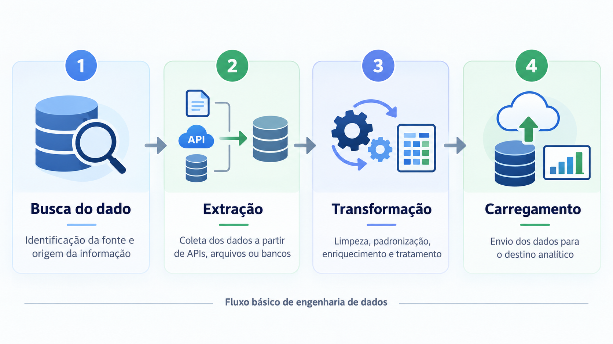

**Interpretação da figura no MedIA:** a busca identifica o arquivo hospitalar e sua competência; a extração o transporta para a camada Bronze; a transformação padroniza os registros na Silver e calcula as estruturas analíticas na Gold; o carregamento materializa as tabelas Delta e as torna disponíveis para o modelo semântico e os visuais.

O desenho abaixo corresponde **ao processo realizado no MedIA** e pode ser renderizado diretamente no GitHub, sem depender de arquivos de imagem adicionais.


> **Nota conceitual:** este fluxo combina práticas de ETL e arquitetura Medallion. Os arquivos podem ser **carregados inicialmente na Bronze** antes de todas as transformações; por isso o armazenamento aparece em mais de um momento da execução. A etapa 4 descreve especificamente a **materialização e disponibilização dos dados tratados para análise**.

### Visão rápida dos contratos entre etapas

| Etapa | Entrada | Trabalho | Saída concreta no MedIA | Como verificamos |
|---|---|---|---|---|
| **Busca** | Necessidade analítica e portais públicos | Localizar fonte, formato, cobertura e chave | Lista de origens SIH, SIM, CNES, IBGE, CID-10 | Existência dos arquivos, nome e competência corretos |
| **Extração** | Arquivos/API/FTP públicos | Baixar, converter quando necessário e registrar metadados | Arquivos sob `Files/media/bronze/` | Presença dos arquivos e conferência inicial de registros |
| **Transformação** | Bronze e dados auxiliares | Tipar, limpar, harmonizar e agregar | `silver_*`, `gold_fato_*`, `gold_dim_*` | Reconciliação Silver↔Gold, chaves e qualidade |
| **Carregamento** | Tabelas Gold validadas | Gravar Delta e disponibilizar via Lakehouse/OneLake/modelo semântico | Tabelas `dbo.gold_*` e relatórios MedIA | Consulta no Lakehouse/SQL, atualização e cards Power BI |

---


## 3. Etapa 1 — Busca do dado

**Objetivo:** encontrar fontes públicas confiáveis e identificar **o que existe, onde está, de qual período é e o que pode ser medido** antes de começar a extração.

### 3.1. Identificamos a necessidade analítica

Antes de baixar arquivos, definimos as perguntas que os dashboards precisam responder: número de AIHs, valor SIH, diagnósticos CID-10, óbitos hospitalares, mortalidade, sexo, residência, causas básicas e distribuição regional. Essa definição determina **quais campos precisamos coletar** e quais fontes não podem ser substituídas umas pelas outras.

### 3.2. Localizamos as fontes e seus papéis

| Fonte localizada | Conjunto no projeto | O que buscamos | Escopo demonstrado |
|---|---|---|---|
| **Departamento de Informática do Sistema Único de Saúde (DATASUS) — Sistema de Informações Hospitalares do Sistema Único de Saúde (SIH/SUS)** | RD / AIH | Internação, CID principal, CNES, valor, dias de permanência, indicador de óbito, município, competência | Piloto `RDMS2401`, **MS jan/2024** |
| **Departamento de Informática do Sistema Único de Saúde (DATASUS) — Sistema de Informações sobre Mortalidade (SIM)** | DO | Data do óbito, CID causa básica, sexo, município de residência e atributos de mortalidade | Arquivo `DO24OPEN`, **Brasil 2024** |
| **Departamento de Informática do Sistema Único de Saúde (DATASUS) — Cadastro Nacional de Estabelecimentos de Saúde (CNES)** | ST e LT | Cadastro de estabelecimentos e características/quantidades de leitos | `STMS2401` e `LTMS2401`, **MS jan/2024**, obtidos em Bronze |
| **Instituto Brasileiro de Geografia e Estatística (IBGE)** | Regiões, UFs e localidades | Nomes oficiais e identificadores territoriais | Dimensões geográficas |
| **Classificação Estatística Internacional de Doenças e Problemas Relacionados à Saúde, 10ª revisão (CID-10)** | Catálogo de códigos e descrições | Traduzir códigos como `J189` em nome do diagnóstico | CSV em português, integrado ao relatório |

### 3.3. Analisamos metadados antes do download

Para cada fonte verificamos: identificação do sistema, nome do arquivo, UF ou abrangência nacional, competência/ano, formato, tamanho ou quantidade esperada de registros, periodicidade, colunas-chave e regras de acesso.

**Exemplos de interpretação correta dos nomes:**

- `RDMS2401`: arquivo RD do SIH referente a **MS**, competência **01/2024**.
- `DO24OPEN`: arquivo do SIM referente ao **ano de 2024**, com abrangência **nacional** neste projeto; não deve ser classificado como “somente MS”.
- `STMS2401.dbc`: estabelecimentos do CNES, MS, jan/2024.
- `LTMS2401.dbc`: registros de leitos do CNES, MS, jan/2024.

### 3.4. Avaliamos a viabilidade de extração

O processo encontrou dificuldades reais: indisponibilidade temporária de catálogos CNES e limites de capacidade de sessões Spark. Para o CNES, quando o catálogo consultado via biblioteca apresentou erro HTTP 503, foi utilizado **acesso direto aos arquivos públicos DATASUS via FTP**. Essa decisão preservou a capacidade de obter os dados do piloto sem confundir falha da ferramenta com ausência do dado.

### 3.5. Resultado e motivo da etapa

**Saída:** inventário conceitual das fontes, competências, formatos e chaves; definição clara do recorte do projeto.

**Por que foi feita:** impede baixar arquivos errados, rotular um arquivo nacional como estadual ou gerar gráficos que impliquem cobertura não disponível.

**Regra de qualidade:** registrar a cobertura real, em vez de supor que todos os anos/UFs existentes no catálogo já foram processados.

---


## 4. Etapa 2 — Extração

**Objetivo:** obter os registros das fontes identificadas, preservando os dados originais e a rastreabilidade de cada arquivo. Esta é a passagem da **fonte externa para a área Bronze do OneLake**.

### 4.1. Definimos o mecanismo de leitura por fonte

- **SIH/SUS:** consulta/obtenção do arquivo reduzido RD por competência e UF, com uso de recursos da biblioteca **PySUS** quando disponíveis. No piloto, o arquivo resultante foi trabalhado em formato Parquet.
- **SIM/DO:** obtenção do arquivo nacional anual 2024 e preservação dos registros com informação de óbito; depois os dados foram estruturados para processamento Spark.
- **CNES/ST e CNES/LT:** download direto dos arquivos **DBC** disponibilizados no FTP DATASUS, após dificuldades no catálogo da biblioteca.
- **IBGE:** leitura de referências oficiais de regiões, UFs e municípios para padronização das dimensões territoriais.
- **CID-10:** importação de catálogo em português, com código e descrição, para enriquecer a interpretação dos diagnósticos no Power BI.

### 4.2. Tratamos o formato de transporte sem perder o dado

Nem todos os arquivos DATASUS chegam prontos para análise em Spark. No piloto CNES, por exemplo, o arquivo `DBC` foi convertido para formato intermediário `DBF` e depois para **Parquet**. A API de conversão efetivamente utilizada no ambiente foi **`pyreaddbc.dbc2dbf`**, com leitura do DBF e gravação colunar.

Durante a extração, preservar códigos como **CNES, CID e município como texto**, para não perder zeros à esquerda. Converter em números só as métricas cuja semântica é realmente numérica (por exemplo, `QT_EXIST` dos leitos), na etapa de transformação.

### 4.3. Organizamos os arquivos na Bronze

O Lakehouse analítico é `lh_media_analytics`. O diretório lógico de projeto é `Files/media/` e possui áreas `bronze`, `silver`, `gold`, `config`, `logs` e `quarantine` conforme a configuração do ambiente.

Exemplo real da árvore de arquivos:

```text
lh_media_analytics
└── Files/
    └── media/
        ├── bronze/
        │   ├── sih/
        │   │   └── uf=MS/ano=2024/mes=01/ ... RDMS2401.parquet
        │   ├── sim/
        │   │   └── ... DO24OPEN.parquet
        │   └── cnes/
        │       ├── grupo=ST/uf=MS/ano=2024/mes=01/
        │       │   ├── STMS2401.dbc
        │       │   └── STMS2401.parquet
        │       └── grupo=LT/uf=MS/ano=2024/mes=01/
        │           ├── LTMS2401.dbc
        │           └── LTMS2401.parquet
        ├── silver/
        ├── gold/
        ├── logs/
        ├── config/
        └── quarantine/
```

> Os caminhos relativos de SIH e SIM podem variar conforme a versão do pipeline. Os caminhos CNES acima correspondem à estrutura efetivamente utilizada no piloto. As tabelas persistidas em `Tables/dbo` são distintas das pastas de arquivos em `Files/`.

### 4.4. Fizemos conferências iniciais de ingestão

No recorte CNES MS 01/2024 foram obtidos e convertidos:

| Arquivo Bronze | Registros de origem | Observação |
|---|---:|---|
| **STMS2401** | **5.598** | 5.598 códigos CNES distintos observados na extração |
| **LTMS2401** | **1.034** | Apenas **142 CNES distintos**, pois cada estabelecimento pode ter linhas por tipo de leito |

**Não interpretar as 1.034 linhas de LT como 1.034 leitos.** Os valores de capacidade estão em campos quantitativos como `QT_EXIST` e `QT_SUS`, com semântica própria.

### 4.5. Registramos a procedência e o resultado

A extração deve conservar: `fonte`, `arquivo`, `uf`, `ano`, `mes`, `periodicidade`, formato e local de armazenamento, quantidade de registros e situação da execução. O projeto utiliza caminhos de manifesto/log e tabelas de controle para esse fim.

**Saída:** arquivos brutos/intermediários na Bronze, prontos para serem lidos e interpretados.

**Por que foi feita:** manter evidência verificável da origem de cada informação e permitir reprocessamento sem confundir coleta, tratamento e apresentação.

---


## 5. Etapa 3 — Transformação

**Objetivo:** fazer os registros coletados ficarem consistentes, interpretáveis e adequados aos indicadores. No MedIA, a transformação é organizada nas camadas **Silver** (limpeza/padronização) e **Gold** (modelagem analítica).

### 5.1. Primeira parte: Bronze → Silver

Na Silver, os arquivos deixam de ser apenas conjuntos de dados brutos e passam a possuir **colunas e tipos estáveis**.

Passos lógicos realizados no projeto:

1. **Leitura dos Parquets/arquivos Bronze**, preservando a referência à fonte e à competência.
2. **Normalização de nomes de campos** para facilitar a integração de fontes com esquemas diferentes.
3. **Tipagem de colunas**: datas como datas, valores financeiros como números apropriados, quantidades como números e códigos de identificação como texto quando necessário.
4. **Padronização CID-10**: códigos escritos como `J18.9` ou com espaços passam a um formato padronizado como `J189`, usado como chave de diagnóstico.
5. **Padronização geográfica**: extração de UF de residência e normalização dos códigos municipais. Os códigos municipais DATASUS de seis posições exigem atenção ao associá-los aos identificadores IBGE de sete posições.
6. **Tratamento de valores ausentes e indicadores**: `indicador_obito` precisa distinguir `1`, `0` e valor não informado. Valores nulos não devem ser silenciosamente convertidos em zero.
7. **Validação e reconciliação**: verificar colunas obrigatórias, chaves, domínio dos valores e compatibilidade com as dimensões.

**Tabelas Silver observadas:** `dbo.silver_sih_internacoes` e `dbo.silver_sim_obitos`. A transformação CNES para Silver estava em evolução e não deve ser descrita como integralmente concluída em toda versão do projeto.

### 5.2. Segunda parte: Silver → Gold

Na Gold, o dado passa a ser estruturado em **tabelas fato e dimensão**, adequadas ao Power BI. O objetivo deixa de ser somente limpar os registros e passa a ser responder perguntas analíticas com desempenho e precisão.

**Dimensões construídas ou utilizadas:**

- `gold_dim_tempo`: `ano`, `mes`, `ano_mes`, início do mês, trimestre, semestre.
- `gold_dim_uf`: código e nome da UF, região correspondente.
- `gold_dim_regiao`: nomes/códigos das macrorregiões.
- `gold_dim_localidade`: referências municipais, dependentes de correspondência de chaves.
- `gold_dim_cid`: códigos CID e atributos de classificação; descrições textuais foram enriquecidas no relatório pelo catálogo CID-10.

**Fatos centrais:**

- `gold_fato_internacoes`: agrupa registros SIH por **UF e município de residência, competência, CID e CNES**. Contém medidas como `quantidade_aih`, `valor_total`, `valor_uti`, `total_dias_permanencia` e `obitos_hospitalares`.
- `gold_fato_mortalidade`: agrupa eventos SIM por **UF e município de residência, ano/mês da ocorrência do óbito, causa básica CID e sexo**. Contém `quantidade_obitos`.

**O que significa AIH (Autorização de Internação Hospitalar)?** A AIH é um documento/registro administrativo utilizado no Sistema de Informações Hospitalares do Sistema Único de Saúde para autorizar e processar a internação no âmbito do SUS. A sigla no plural é **AIHs**. O registro guarda informações como estabelecimento, diagnóstico, permanência e valores processados. Não constitui um identificador de paciente único: análises de AIHs **não devem ser rotuladas automaticamente como número de pacientes distintos**. Na transformação Gold, `quantidade_aih` indica **quantas AIHs originais foram consolidadas naquela combinação de chaves**. A função `SUM()` recupera o total desse grupo de registros; `COUNTROWS()` contaria somente os grupos.

**Por que isso importa?** Dois estabelecimentos podem registrar o mesmo volume agregado em uma linha cada, mas com quantidades distintas de AIHs. A soma dos pesos é indispensável para preservar os totais da fonte e calcular médias ponderadas e proporções coerentes.

**Diferença crítica:** uma linha das fatos Gold **não corresponde necessariamente a um evento**. As fatos foram agregadas por grupos. Por isso, o total de internações não deve ser contado com `COUNTROWS(gold_fato_internacoes)`; deve ser calculado pela **soma de `quantidade_aih`**. Para óbitos, somar `quantidade_obitos`.

### 5.3. Tratamento da dimensão temporal

A data tem semântica diferente entre sistemas:

| Sistema | Campo representando o período | Significado correto |
|---|---|---|
| **SIH** | `ano_competencia`, `mes_competencia` → `ano_mes` | Competência administrativa mensal da AIH |
| **SIM** | `data_obito` → ano e mês | **Mês de ocorrência** do óbito, mesmo quando o arquivo de origem é anual |
| **Controle de cobertura SIM** | `ano_arquivo`, `mes = null` | **Periodicidade do arquivo anual**, não ausência de data do evento |

A dimensão `gold_dim_tempo` deve utilizar a chave `AAAAMM` (por exemplo, `202401`). No relatório, um nome de mês como “janeiro” é **rótulo de apresentação**, classificado pela coluna numérica `mes`.

### 5.4. Classificamos causas cardiovasculares

Os indicadores cardiovasculares utilizam uma regra baseada na causa básica CID-10, que no código do projeto identifica códigos iniciados pelo padrão do capítulo `I` (doenças do aparelho circulatório). Essa **regra deve ser mantida explícita** e não deve ser confundida com a taxa por população.

### 5.5. Construímos também controles de cobertura

A Gold possui `gold_controle_cobertura`, para registrar origem, UF, ano, mês, periodicidade, abrangência e volume de registros, e `gold_indicadores_uf_ano`, contendo indicadores agregados por UF/ano. Essas tabelas servem para cobertura e sínteses administrativas, mas **não devem ser unidas ao detalhe mensal de modo a multiplicar totais anuais**.

### 5.6. Validamos antes do carregamento analítico

Os testes incluem:

- Conferir se `SUM(quantidade_aih)` na Gold corresponde à contagem elegível da Silver SIH.
- Conferir se `SUM(quantidade_obitos)` na Gold corresponde aos eventos elegíveis da Silver SIM.
- Verificar unicidade das chaves de dimensão (`cid_codigo`, `ano_mes`, `uf_codigo`) e presença das chaves da fato nas dimensões.
- Verificar se a UF de residência foi determinada corretamente e se os períodos são válidos.
- Separar **falha técnica**, **alerta de cobertura** e **ausência de dado**.

**Saída:** tabelas com fatos, dimensões, indicadores agregados e controles de cobertura, com regras de negócio claras.

**Por que foi feita:** evitar que dados brutos criem rankings, totais, taxas ou filtros incorretos no Power BI.

---


## 6. Etapa 4 — Armazenamento e carregamento

**Objetivo:** gravar os resultados analíticos tratados e torná-los acessíveis com consistência ao modelo semântico e ao relatório.

### Arquitetura visual do armazenamento

A arquitetura separa **arquivos de entrada** (`Files/media/bronze`) de **tabelas estruturadas** (`Tables/dbo`). As tabelas Silver são padronizadas, enquanto as Gold representam dados prontos para análise. Logs e controles acompanham o processamento. O Lakehouse `lh_media_bi` pode referenciar as Gold por atalhos OneLake, sem uma nova cópia materializada.

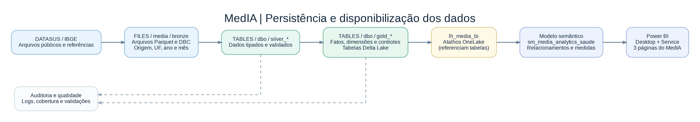

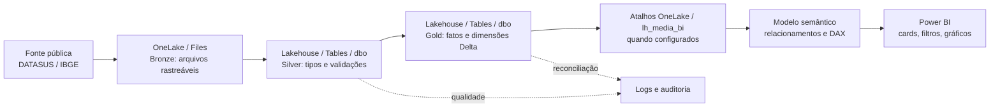

### 6.1. Persistimos as tabelas no Lakehouse

Os dados preparados na Gold são gravados em **tabelas Delta Lake** no Lakehouse `lh_media_analytics`, sob o esquema `dbo` quando aplicável. Os arquivos Bronze ficam em `Files/`; as tabelas analíticas são consumidas em `Tables/`.

Principais conjuntos:

```text
lh_media_analytics / Tables / dbo
├── gold_fato_internacoes
├── gold_fato_mortalidade
├── gold_dim_tempo
├── gold_dim_uf
├── gold_dim_regiao
├── gold_dim_localidade
├── gold_dim_cid
├── gold_indicadores_uf_ano
└── gold_controle_cobertura
```

A presença de qualquer tabela na relação acima precisa ser conferida no workspace/versão do ambiente antes de declarar atualização concluída. As fatos CNES só devem ser incluídas nessa lista após validação da Silver correspondente e materialização real.

### 6.2. Disponibilizamos os dados no workspace de BI

O projeto possui dois ambientes relevantes:

- `lh_media_analytics`: Lakehouse que recebe o processamento analítico.
- `lh_media_bi`: Lakehouse de consumo criado na área de trabalho **MedIA**, com utilização de **atalhos do OneLake** para apontar para tabelas de origem, quando configurados.

**Por que usar atalho?** Reutilizar tabelas sem depender de cópias manuais, respeitando permissões e compatibilidade do endpoint de consulta.

### Fluxo visual do carregamento até o relatório

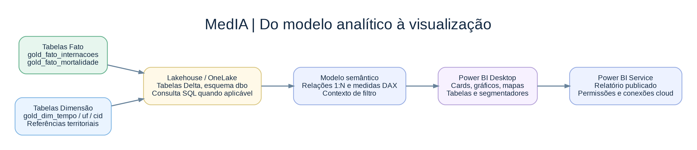

O **endpoint SQL do Lakehouse** permite consultar as tabelas Delta usando SQL. Ele não deve ser confundido com uma *view* nem precisa necessariamente ser uma etapa material de movimentação de dados: o modelo semântico pode utilizar mecanismos de conexão diferentes, conforme sua configuração (por exemplo, Direct Lake, DirectQuery ou um modelo composto). No MedIA, foram observadas tabelas de origem no modelo remoto e um catálogo CID-10 importado no PBIX.

### 6.3. Conectamos ao modelo semântico

Foi utilizado o modelo semântico `sm_media_analytics_saude` para disponibilizar medidas, chaves e filtros à solução Power BI. O arquivo de relatório `MedIa.pbix` foi observado em modo **Misto**, combinando consumo do modelo remoto e a tabela de descrição CID-10 importada.

As **regras quantitativas** devem permanecer em medidas DAX numéricas reutilizáveis; o HTML é usado somente para **apresentação de cards e perfis**, não como substituto de fonte de dados ou filtro funcional.

### 6.4. Tratamos a dependência do catálogo CID-10

Inicialmente o CSV CID-10 estava em um caminho local de Windows (`Downloads`), o que criou uma dependência de acesso/atualização no Power BI Service. A consulta Power Query foi alterada para uma fonte Web pública com `Web.Contents(...)`, permitindo uma ligação de nuvem, com autenticação **Anônimo** conforme o contexto da fonte.

No projeto, os códigos `cid_codigo` são padronizados e a coluna `cid_rotulo` combina **código + descrição**; a apresentação final optou por manter o código abreviado na barra e exibir o nome completo no **tooltip**. Para impedir que o tooltip repetisse a mesma descrição em todos os códigos, foi adotada uma medida contextual baseada em `SELECTEDVALUE` e `LOOKUPVALUE`.

### 6.5. Publicamos e verificamos o relatório

A publicação envia o relatório e o modelo composto para o serviço. Depois da publicação, deve-se conferir separadamente as **ligações cloud**, credenciais da fonte Web, autenticação e permissões do modelo remoto, especialmente em configurações de DirectQuery/modelo composto.

**Um relatório publicado não significa necessariamente um relatório conectado:** foram observados erros no serviço por credenciais não configuradas. Validar o carregamento dos cards no navegador é parte do carregamento efetivo para consumo.

### 6.6. Resultado e justificativa

**Saída:** tabelas analíticas Delta disponíveis ao Power BI e dashboard publicado, sujeito à validação de conexões e cobertura.

**Por que foi feita:** transformar arquivos e tabelas de processamento em uma base consultável, segura, atualizável e capaz de responder aos filtros do usuário.

---


## 7. Modelo dimensional, fatos, dimensões e relacionamentos


#### O que é Star Schema e como o MedIA o utiliza?

O **modelo dimensional** separa medidas quantitativas (**fatos**) de atributos de análise (**dimensões**). Uma dimensão de tempo responde *quando?*; UF responde *onde?*; CID responde *qual diagnóstico?*. As fatos respondem *quantos? qual valor? quantos dias?*. O **Star Schema** favorece filtragem simples, medidas reutilizáveis e interpretações consistentes.

O MedIA possui **duas fatos centrais**, SIH e SIM, que podem compartilhar dimensões conformadas de tempo, UF e CID **quando suas chaves e semânticas forem compatíveis**. Também há tabelas administrativas e agregadas que não devem ser tratadas como eventos detalhados da mesma natureza.

#### Por que priorizar Star Schema, ou Esquema em Estrela, em vez de Snowflake Schema, ou Esquema em Floco de Neve?

| Critério | **Star Schema — Esquema em Estrela** | **Snowflake Schema — Esquema em Floco de Neve** |
|---|---|---|
| Organização | Dimensões com atributos descritivos próximos das fatos | Dimensões mais normalizadas e ligadas entre si |
| Exemplo territorial | `gold_dim_uf` pode conter a região e seu nome para filtrar a fato diretamente | `gold_dim_regiao` se conecta a `gold_dim_uf`, e esta se conecta à fato |
| Vantagem | Leitura mais direta, relações mais simples para os filtros do Power BI | Menos repetição de atributos e manutenção centralizada de alguns cadastros |
| Cuidado | Pode repetir atributos de descrição nas dimensões | Caminhos mais longos de filtragem, modelo mais difícil de explicar e manter |

**Decisão arquitetural:** o MedIA **prioriza o Esquema em Estrela para análise**, pois as perguntas de negócio passam pelas dimensões de período, unidade federativa e diagnóstico. Isso não impede que a estrutura física tenha elementos mais normalizados, como Região → UF; por isso a descrição correta é **modelo predominantemente dimensional em estrela**, sujeito à verificação dos relacionamentos realmente ativos.

#### Diagrama conceitual

**Imagem 1 — captura da Exibição de Modelo do Power BI:** referência visual fornecida durante a construção do projeto. O print demonstra a disposição e as conexões, mas está pequeno demais para certificar todas as colunas e direções de filtro.

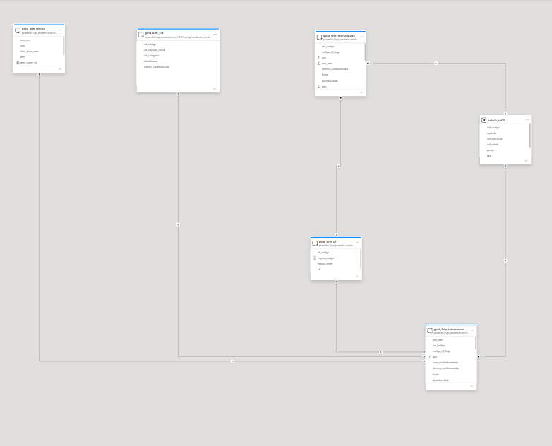

**Imagem 2 — representação lógica legível:** mostra o desenho dimensional recomendado. As linhas tracejadas representam relações cuja atividade/semântica precisam ser conferidas; não é uma exportação automática do modelo publicado.

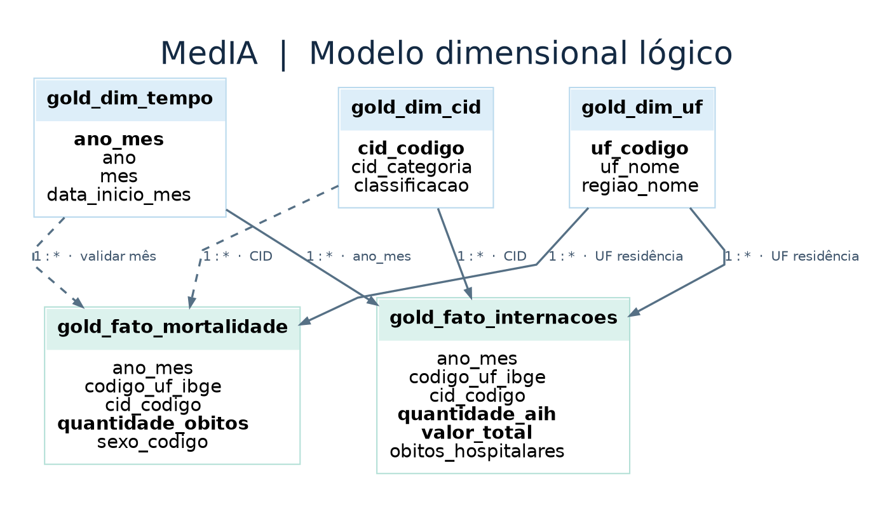

**Visão complementar — esquema em estrela proposto para consumo analítico:**

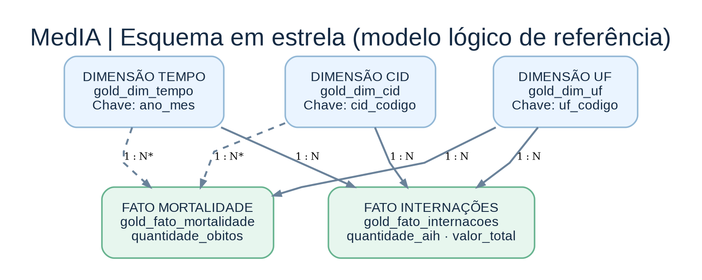

> **Nota de modelagem:** as setas tracejadas em diagramas conceituais representam relações cuja configuração ativa precisa ser auditada no modelo publicado. As imagens ilustrativas **não substituem** a captura original do Power BI nem confirmam automaticamente todas as cardinalidades e direções de filtro.


##### Modelo em Mermaid (visão simplificada)

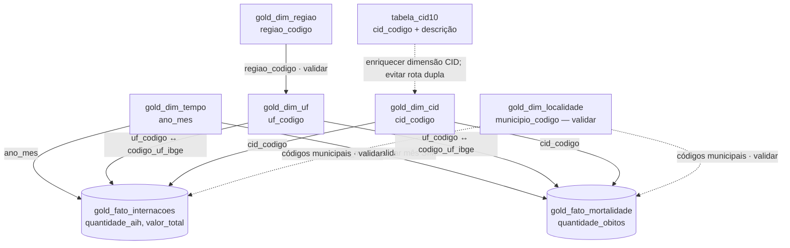

**Legenda:** seta contínua = relação lógica recomendada; tracejada = dependente de validação ou enriquecimento. Mesmo setas contínuas **precisam ser comparadas com as relações ativas do PBIX**.

#### Tabelas por papel

| Tabela | Papel | Grão/identificador principal | Medidas/atributos |
|---|---|---|---|
| `gold_fato_internacoes` | **Fato SIH** | Grupo por município de residência, UF, competência, CID e CNES (pode incluir outras classificações) | `quantidade_aih`, `valor_total`, `valor_uti`, `total_dias_permanencia`, `obitos_hospitalares` |
| `gold_fato_mortalidade` | **Fato SIM** | Grupo de óbitos por atributos de residência, causa, período e sexo (confirmar colunas efetivas) | `quantidade_obitos`, `sexo_codigo`, `cid_codigo` |
| `gold_dim_tempo` | **Dimensão** | `ano_mes` | `ano`, `mes`, `data_inicio_mes`, `trimestre`, `semestre`, `mes_nome_col` (coluna do modelo) |
| `gold_dim_uf` | **Dimensão** | `uf_codigo` ou sigla `uf` conforme relacionamento | `uf_nome`, `regiao_codigo`, `regiao_nome` |
| `gold_dim_regiao` | **Dimensão** | `regiao_codigo` | `regiao_nome` |
| `gold_dim_localidade` | **Dimensão** | Código municipal a validar (`municipio_codigo`) | `municipio_nome`, `uf`, região |
| `gold_dim_cid` | **Dimensão** | `cid_codigo` | `cid_categoria`, `cid_capitulo_inicial`, `doenca_cardiovascular`, `classificacao` |
| `tabela_cid10` | **Referência importada** | `cid_codigo` sem duplicatas | `cid_descricao`, `cid_rotulo`, `capitulo`, `grupo`, `tipo` |
| `gold_indicadores_uf_ano` | **Resumo agregado** | UF × ano | `total_obitos`, `obitos_cardiovasculares`, cobertura e meses carregados |
| `gold_controle_cobertura` | **Controle** | Fonte/UF/competência/arquivo, conforme implementação | `fonte`, `ano`, `mes`, `abrangencia_arquivo`, `registros`, `gerado_em` |

#### Granularidade: por que isso muda o resultado?

**Fato SIH:** uma linha pode representar **muitas AIHs**. Não use contagem de linhas para medir internações. O peso é `quantidade_aih`. Somar valores por CNES e CID exige a chave do grupo correto; adicionar colunas do cadastro CNES com múltiplas linhas por estabelecimento pode **multiplicar valores**.

**Fato SIM:** uma linha também pode representar vários óbitos; usar `SUM(quantidade_obitos)`. O mês da fato deve representar a **data do óbito**, não apenas o mês do arquivo anual `DO24OPEN`.

**Resumos UF × ano:** se relacionar `gold_indicadores_uf_ano` a dimensões mensais sem cuidado, um total anual pode ser repetido 12 vezes. Utilize a tabela de resumo somente na granularidade correta e sem duplicar medidas das fatos.

#### Matriz de relacionamentos

| Dimensão (lado 1) | Fato / destino (lado *) | Chaves candidatas | Cardinalidade esperada | Filtro | Situação |
|---|---|---|---|---|---|
| `gold_dim_tempo` | `gold_fato_internacoes` | `ano_mes` → `ano_mes` | 1:* | Único, dimensão → fato | Chaves documentadas; validar relação ativa |
| `gold_dim_tempo` | `gold_fato_mortalidade` | `ano_mes` → `ano_mes` | 1:* | Único | Validar temporalidade e relação ativa |
| `gold_dim_uf` | `gold_fato_internacoes` | `uf_codigo` → `codigo_uf_ibge` | 1:* | Único | Validar tipos (`inteiro`) e chave ativa |
| `gold_dim_uf` | `gold_fato_mortalidade` | `uf_codigo` → `codigo_uf_ibge` | 1:* | Único | Validar residência e chave ativa |
| `gold_dim_cid` | `gold_fato_internacoes` | `cid_codigo` → `cid_codigo` | 1:* | Único | Confirmar no Desktop |
| `gold_dim_cid` | `gold_fato_mortalidade` | `cid_codigo` → `cid_codigo` | 1:* | Único | Confirmar no Desktop |
| `gold_dim_regiao` | `gold_dim_uf` | `regiao_codigo` → `regiao_codigo` | 1:* | Único | Recomendado se região for navegação em cascata |
| `gold_dim_localidade` | Fatos SIH/SIM | código IBGE municipal compatível com `municipio_codigo_6` | 1:* | Único | **A validar** tamanho de código 6 vs. 7 caracteres |
| `tabela_cid10` | `gold_dim_cid` | `cid_codigo` → `cid_codigo` | Conforme estratégia de enriquecimento | Evitar rotas duplicadas | **Preferir incorporar descrição à dimensão CID** |

**Não reproduzir automaticamente todas essas relações em paralelo.** Se `tabela_cid10` já estiver relacionada a `gold_fato_internacoes`, verifique caminhos entre ela, `gold_dim_cid` e ambas as fatos antes de criar nova relação. O caso real do tooltip mostrou que uma descrição escolhida com agregação “Primeiro” pode ignorar o CID do evento.

#### Chaves técnicas e semânticas

**`ano_mes`**: inteiro `AAAAMM` como `202401`; nunca usar apenas `mes` para relacionar anos diferentes. Ordenar `mes_nome_col` por `mes` e rótulos mês/ano por `ano_mes`.

**`cid_codigo`**: texto padronizado, maiúsculo, sem ponto (`J189`, `O800`). Descrições em catálogo externo, versão/classificação documentada. Validar unicidade antes da relação do lado 1.

**`codigo_uf_ibge`**: código IBGE da UF, geralmente numérico; `uf_residencia` é sigla. Não relacionar código numérico da UF com sigla textual sem transformação.

**`municipio_codigo_6`**: código municipal derivado do DATASUS com 6 posições; bases do IBGE frequentemente empregam código municipal de 7 dígitos. **Não inventar relação direta sem regra de conversão validada**.

**`cnes_estabelecimento`**: texto, preservando zeros à esquerda. Não relacionar com uma tabela CNES tipo LT que contém várias linhas por estabelecimento sem tratamento do grão.

#### Verificação no Power BI Desktop

1. Abrir **Exibição de modelo** e localizar relações realmente ativas.
2. Conferir **1:* , direção Única** e as mesmas tipagens de chave.
3. Identificar conexões DirectQuery/Import, especialmente o CSV CID-10 importado num **modelo composto**.
4. Testar filtro `ano_mes=202401` separadamente em `[Total_de_AIHs]` e `[Total_de_Óbitos]`.
5. Testar uma UF e um CID conhecido, comparando antes/depois.
6. Procurar ambiguidade, seleção que não chega à fato e duplicação por pontes de múltiplos caminhos.
7. Registrar um **inventário de relações efetivas** com tabela origem, destino, colunas, cardinalidade, direção e ativa/inativa. **Este inventário definitivo depende da leitura do PBIX**.

#### Recomendação de destino

Criar uma **dimensão CID-10 única** (`gold_dim_cid`) contendo `cid_codigo`, `cid_descricao`, `cid_rotulo`, classificação cardiovascular e demais atributos; relacioná-la uma vez a cada fato (1:*). A tabela de descrições importada pode ser usada como fonte de enriquecimento, mas não deve criar dois caminhos ativos concorrentes que produzam totais incorretos.

---


## 8. Medidas DAX: definição e justificativa

**DAX** significa *Data Analysis Expressions* (**Expressões de Análise de Dados**), linguagem de cálculo do Microsoft Power BI. Nesta seção, cada medida é acompanhada do motivo de existir e da forma correta de interpretá-la. As expressões apresentadas são referências técnicas, não uma exportação certificada do modelo publicado.


#### Princípio geral

As fatos Gold são **agregadas**: uma linha da fato pode representar **diversas AIHs ou diversos óbitos**. As medidas centrais devem somar as colunas agregadas (`quantidade_aih`, `quantidade_obitos`) em vez de contar linhas. As fórmulas DAX abaixo são **definições recomendadas**, não extração das expressões originais do modelo publicado. Os nomes das medidas foram identificados nas capturas do MedIA; confirme campo, tipo e filtros ativos antes de substituir medidas existentes.

#### Dicionário resumido de medidas

| Medida identificada | Página | Por que foi criada? | Tipo |
|---|---|---|---|
| `Total_de_AIHs` | Geral / Internações | Quantificar AIHs somando o peso dos grupos na fato | Aditiva |
| `Valor_Total_SIH` | Geral / Internações | Apresentar o valor financeiro registrado no SIH | Aditiva |
| `Óbitos_Hospitalares_SIH` | Geral / Internações | Quantificar AIHs com desfecho de óbito | Aditiva, conforme regra de origem |
| `Permanência_Média_SIH` | Internações | Resumir duração média por AIH | Razão ponderada |
| `Valor_Médio_por_AIH` | Internações | Comparar valor médio por internação | Razão |
| `%_Óbitos_Hospitalares` | Internações | Quantificar proporção bruta de óbitos por AIH | Percentual |
| `Total_de_Estabelecimentos` | Internações | Mostrar códigos CNES distintos presentes nas AIHs | Distinct count |
| `Total_de_Óbitos` | Geral / Mortalidade | Quantificar eventos do SIM | Aditiva |
| `Óbitos_Cardiovasculares` | Mortalidade | Separar causas CID cardiovasculares | Aditiva filtrada |
| `Percentual_Óbitos_Cardiovasculares` | Mortalidade | Indicar participação dessas causas no total | Percentual |
| `UFs_Com_Óbitos` | Mortalidade | Quantificar cobertura geográfica observada | Distinct count |
| `Descricao_CID_Tooltip` | Internações | Exibir o nome da doença que corresponde ao CID da barra | Texto contextual |
| `Descricao_CID_mortalidade` | Mortalidade | Mesmo propósito aplicado à fato SIM | Texto contextual |
| `Perfil_Mortalidade_HTML` | Mortalidade | Apresentar várias medidas por sexo em painel compacto | Apresentação HTML |
| `Card_*_HTML` | Cards | Exibir rótulo e valor em estilo institucional compacto | Apresentação HTML |

#### Definições técnicas e exemplos DAX

##### Quantidade de AIHs

```dax
Total_de_AIHs =
SUM('gold_fato_internacoes'[quantidade_aih])
```

**Razão:** a fato está agrupada; `COUNTROWS(gold_fato_internacoes)` mede **número de grupos**, não quantidade de AIHs. **Unidade:** AIHs. **Fonte:** SIH/SUS. **Não mede:** pacientes únicos.

##### Valor total SIH

```dax
Valor_Total_SIH =
SUM('gold_fato_internacoes'[valor_total])
```

**Razão:** somar o valor administrativo do recorte. **Unidade:** reais (R$). **Cuidado:** não rotular automaticamente como “custo hospitalar real”.

##### Óbitos hospitalares no SIH

```dax
Óbitos_Hospitalares_SIH =
SUM('gold_fato_internacoes'[obitos_hospitalares])
```

**Razão:** identificar o subconjunto de AIHs com desfecho de óbito documentado. Requer validação de como o campo foi agregado a partir de `indicador_obito` na Silver. Não somar com `[Total_de_Óbitos]` (SIM).

##### Permanência média do SIH

```dax
Permanência_Média_SIH =
DIVIDE(
    SUM('gold_fato_internacoes'[total_dias_permanencia]),
    [Total_de_AIHs]
)
```

**Razão:** usar o total de dias dividido pela quantidade de AIHs, em vez de média simples de linhas agregadas. **Unidade:** dias por AIH. **Ponto a validar:** regra para AIHs com permanência não informada; se houver exclusões, denominador deve refletir os registros elegíveis.

##### Valor médio por AIH

```dax
Valor_Médio_por_AIH =
DIVIDE([Valor_Total_SIH], [Total_de_AIHs])
```

**Razão:** criar valor comparável, evitando confundir gasto total com valor médio. **Unidade:** R$/AIH; depende de valor e contagem de AIHs válidos no mesmo recorte.

##### Proporção bruta de óbitos hospitalares

```dax
%_Óbitos_Hospitalares =
DIVIDE([Óbitos_Hospitalares_SIH], [Total_de_AIHs])
```

**Razão:** relacionar desfechos à atividade hospitalar. **Formato:** porcentagem. **Exemplo:** `757 / 17.755 ≈ 4,26%`. **Não afirmar:** mortalidade ajustada por gravidade ou risco clínico. **A validar:** se o cálculo operacional exclui óbitos não informados, documentar o denominador diferente de todas as AIHs.

##### Estabelecimentos com AIHs registradas

```dax
Total_de_Estabelecimentos =
CALCULATE(
    DISTINCTCOUNT('gold_fato_internacoes'[cnes_estabelecimento]),
    NOT ISBLANK('gold_fato_internacoes'[cnes_estabelecimento])
)
```

**Razão:** quantificar códigos CNES presentes nas AIHs carregadas. **Unidade:** estabelecimentos distintos **com AIH**. **Cuidado:** zeros à esquerda nos códigos CNES; não corresponde ao cadastro completo do CNES.

##### Total de óbitos SIM

```dax
Total_de_Óbitos =
SUM('gold_fato_mortalidade'[quantidade_obitos])
```

**Razão:** evento registrado no SIM, por causa básica e demais dimensões presentes na fato. **Unidade:** óbitos. **Cuidado:** não substituir por `COUNTROWS` numa fato agregada.

##### Óbitos cardiovasculares

```dax
Óbitos_Cardiovasculares =
CALCULATE(
    [Total_de_Óbitos],
    'gold_fato_mortalidade'[doenca_cardiovascular] = TRUE()
)
```

**Razão:** calcular subconjunto de causa básica cuja CID pertence à classificação cardiovascular. **Definição observada no modelo de dados:** marcador `doenca_cardiovascular`. **A validar:** tipo físico do marcador e definição institucional dos códigos usados (por exemplo, capítulo I da CID-10).

##### Participação cardiovascular

```dax
Percentual_Óbitos_Cardiovasculares =
DIVIDE([Óbitos_Cardiovasculares], [Total_de_Óbitos])
```

**Razão:** contextualizar o volume cardiovascular no total de óbitos. **Formato obrigatório:** porcentagem, por exemplo `0,26` → `26,0%`. **Não é:** taxa por população.

##### UFs com óbitos

```dax
UFs_Com_Óbitos =
CALCULATE(
    DISTINCTCOUNT('gold_fato_mortalidade'[uf_residencia]),
    NOT ISBLANK('gold_fato_mortalidade'[uf_residencia])
)
```

**Razão:** mostrar abrangência territorial presente na carga/seleção, tipicamente 27 UFs no conjunto nacional. **Cuidado:** uma UF sem óbitos na seleção pode desaparecer da contagem; isso não significa que deixou de existir.

##### Tooltip de descrição CID — Internações

```dax
Descricao_CID_Tooltip =
VAR Codigo = SELECTEDVALUE('gold_fato_internacoes'[cid_codigo])
RETURN
    IF(
        ISBLANK(Codigo),
        BLANK(),
        LOOKUPVALUE(
            'tabela_cid10'[cid_descricao],
            'tabela_cid10'[cid_codigo], Codigo,
            "Descrição não encontrada"
        )
    )
```

**Razão:** quando a barra usa `cid_codigo` da **fato**, uma coluna da tabela importada no tooltip com agregação “Primeiro” pode mostrar o **mesmo nome para todos os CIDs**. A medida busca explicitamente pelo código contextual. **Pré-condição:** uma descrição consistente por código no catálogo. **Comportamento esperado:** `J189` → *Pneumonia não especificada*.

##### Tooltip — Mortalidade

```dax
Descricao_CID_mortalidade =
VAR Codigo = SELECTEDVALUE('gold_fato_mortalidade'[cid_codigo])
RETURN
    IF(
        ISBLANK(Codigo),
        BLANK(),
        LOOKUPVALUE(
            'tabela_cid10'[cid_descricao],
            'tabela_cid10'[cid_codigo], Codigo,
            "Descrição não encontrada"
        )
    )
```

**Razão:** garantir rótulo clínico correto para a causa básica selecionada, sem depender da direção de filtro entre fato e catálogo.

#### Medidas HTML: finalidade, estrutura e código de referência

Os cards nativos apresentavam nomes técnicos de medidas e diferenças de tipografia em relação ao desenho no Figma. As medidas HTML foram usadas para **padronizar título, número, altura e cores**, sem alterar a definição analítica da medida numérica.

**Separação de responsabilidades:** a medida `[Total_de_AIHs]` calcula a quantidade; `Card_AIHs_HTML` exibe esse número com o texto “Internações registradas”. A primeira participa das regras de negócio e das comparações; a segunda serve de saída para o visual **HTML Content Secure**. O cartão de HTML **não é um segmentador**, não cria relacionamento e não deve substituir uma medida numérica no eixo de gráficos.

**Padrão visual compacto do projeto:** `height:43px`, `background:transparent`, `border:none`, `box-shadow:none`, texto de título com 10px e valor com 20px, em cores `#64748B` e `#142A43`. O fundo e a faixa lateral colorida já pertencem ao layout do Power BI; duplicar bordas ou aumentar a altura do HTML introduz recortes ou barras de rolagem.

**Status do código abaixo:** `Card_AIHs_HTML` segue o padrão efetivamente compartilhado no desenvolvimento. As demais expressões são **implementações de referência reconstruídas a partir dos nomes das medidas e dos valores exibidos nas telas**; não foram extraídas automaticamente do PBIX publicado. Ajustar nomes e formatação caso o modelo atual use outra convenção.

##### Catálogo das medidas HTML por página

| Página | Medida HTML de referência | Texto que deve aparecer | Medida numérica | Justificativa |
|---|---|---|---|---|
| Visão Geral | `Card_AIHs_HTML` | Internações registradas | `[Total_de_AIHs]` | contagem abreviada; 17.755 AIHs ≈ 17,8 mil |
| Visão Geral | `Card_Total_Obitos_HTML` | Óbitos registrados | `[Total_de_Óbitos]` | contagem de óbitos do Sistema de Informações sobre Mortalidade em milhões |
| Visão Geral | `Card_Valor_Total_SIH_HTML` | Valor total de internações | `[Valor_Total_SIH]` | soma financeira administrativa em milhões de reais |
| Visão Geral | `Card_Obitos_Hospitalares_HTML` | Óbitos hospitalares | `[Óbitos_Hospitalares_SIH]` | desfechos administrativos na base hospitalar |
| Internações | `Card_Permanencia_HTML` | Permanência média | `[Permanência_Média_SIH]` | média ponderada de dias por autorização |
| Internações | `Card_Valor_Medio_AIH_HTML` | Valor médio por AIH | `[Valor_Médio_por_AIH]` | média financeira em R$/autorização |
| Internações | `Card_Percentual_Obitos_HTML` | Proporção de óbitos | `[%_Óbitos_Hospitalares]` | percentual bruto de AIHs com óbito |
| Internações | `Card_Estabelecimentos_HTML` | Estabelecimentos com AIHs | `[Total_de_Estabelecimentos]` | contagem distinta de códigos CNES que aparecem nas AIHs |
| Mortalidade | `Card_Mortalidade_Obitos_HTML` | Óbitos registrados | `[Total_de_Óbitos]` | contagem de óbitos do Sistema de Informações sobre Mortalidade |
| Mortalidade | `Card_Mortalidade_Cardiovasculares_HTML` | Óbitos cardiovasculares | `[Óbitos_Cardiovasculares]` | óbitos cuja causa básica pertence ao grupo cardiovascular |
| Mortalidade | `Card_Mortalidade_Percentual_HTML` | Participação cardiovascular | `[Percentual_Óbitos_Cardiovasculares]` | participação no total de óbitos; não é taxa populacional |
| Mortalidade | `Card_Mortalidade_UFs_HTML` | UFs com óbitos | `[UFs_Com_Óbitos]` | número de Unidades da Federação com óbitos na seleção |

##### Código de referência das medidas HTML dos quatro cards da Visão Geral

**Internações registradas** — contagem abreviada; 17.755 AIHs ≈ 17,8 mil.

```dax
Card_AIHs_HTML =
VAR Valor = [Total_de_AIHs]
VAR TextoValor =
    IF(
        ISBLANK(Valor),
        "—",
        FORMAT(DIVIDE(Valor, 1000), "0.0", "pt-BR") & " mil"
    )
RETURN
    "<div style='font-family:Segoe UI,Arial,sans-serif;box-sizing:border-box;width:100%;height:43px;margin:0;padding:2px 4px;background:transparent;border:none;box-shadow:none;overflow:hidden;'>" &
    "<div style='font-size:10px;line-height:14px;font-weight:500;color:#64748B;'>Internações registradas</div>" &
    "<div style='font-size:20px;line-height:25px;font-weight:700;color:#142A43;white-space:nowrap;'>" & TextoValor & "</div>" &
    "</div>"
```

**Óbitos registrados** — contagem de óbitos do Sistema de Informações sobre Mortalidade em milhões.

```dax
Card_Total_Obitos_HTML =
VAR Valor = [Total_de_Óbitos]
VAR TextoValor =
    IF(
        ISBLANK(Valor),
        "—",
        FORMAT(DIVIDE(Valor, 1000000), "0.00", "pt-BR") & " Mi"
    )
RETURN
    "<div style='font-family:Segoe UI,Arial,sans-serif;box-sizing:border-box;width:100%;height:43px;margin:0;padding:2px 4px;background:transparent;border:none;box-shadow:none;overflow:hidden;'>" &
    "<div style='font-size:10px;line-height:14px;font-weight:500;color:#64748B;'>Óbitos registrados</div>" &
    "<div style='font-size:20px;line-height:25px;font-weight:700;color:#142A43;white-space:nowrap;'>" & TextoValor & "</div>" &
    "</div>"
```

**Valor total de internações** — soma financeira administrativa em milhões de reais.

```dax
Card_Valor_Total_SIH_HTML =
VAR Valor = [Valor_Total_SIH]
VAR TextoValor =
    IF(
        ISBLANK(Valor),
        "—",
        "R$ " & FORMAT(DIVIDE(Valor, 1000000), "0.00", "pt-BR") & " Mi"
    )
RETURN
    "<div style='font-family:Segoe UI,Arial,sans-serif;box-sizing:border-box;width:100%;height:43px;margin:0;padding:2px 4px;background:transparent;border:none;box-shadow:none;overflow:hidden;'>" &
    "<div style='font-size:10px;line-height:14px;font-weight:500;color:#64748B;'>Valor total de internações</div>" &
    "<div style='font-size:20px;line-height:25px;font-weight:700;color:#142A43;white-space:nowrap;'>" & TextoValor & "</div>" &
    "</div>"
```

**Óbitos hospitalares** — desfechos administrativos na base hospitalar.

```dax
Card_Obitos_Hospitalares_HTML =
VAR Valor = [Óbitos_Hospitalares_SIH]
VAR TextoValor =
    IF(
        ISBLANK(Valor),
        "—",
        FORMAT(Valor, "#,0", "pt-BR")
    )
RETURN
    "<div style='font-family:Segoe UI,Arial,sans-serif;box-sizing:border-box;width:100%;height:43px;margin:0;padding:2px 4px;background:transparent;border:none;box-shadow:none;overflow:hidden;'>" &
    "<div style='font-size:10px;line-height:14px;font-weight:500;color:#64748B;'>Óbitos hospitalares</div>" &
    "<div style='font-size:20px;line-height:25px;font-weight:700;color:#142A43;white-space:nowrap;'>" & TextoValor & "</div>" &
    "</div>"
```

##### Código de referência das medidas HTML dos quatro cards de Internações Hospitalares

**Permanência média** — média ponderada de dias por autorização.

```dax
Card_Permanencia_HTML =
VAR Valor = [Permanência_Média_SIH]
VAR TextoValor =
    IF(
        ISBLANK(Valor),
        "—",
        FORMAT(Valor, "0.00", "pt-BR") & " dias"
    )
RETURN
    "<div style='font-family:Segoe UI,Arial,sans-serif;box-sizing:border-box;width:100%;height:43px;margin:0;padding:2px 4px;background:transparent;border:none;box-shadow:none;overflow:hidden;'>" &
    "<div style='font-size:10px;line-height:14px;font-weight:500;color:#64748B;'>Permanência média</div>" &
    "<div style='font-size:20px;line-height:25px;font-weight:700;color:#142A43;white-space:nowrap;'>" & TextoValor & "</div>" &
    "</div>"
```

**Valor médio por AIH** — média financeira em R$/autorização.

```dax
Card_Valor_Medio_AIH_HTML =
VAR Valor = [Valor_Médio_por_AIH]
VAR TextoValor =
    IF(
        ISBLANK(Valor),
        "—",
        "R$ " & FORMAT(Valor, "#,##0.00", "pt-BR")
    )
RETURN
    "<div style='font-family:Segoe UI,Arial,sans-serif;box-sizing:border-box;width:100%;height:43px;margin:0;padding:2px 4px;background:transparent;border:none;box-shadow:none;overflow:hidden;'>" &
    "<div style='font-size:10px;line-height:14px;font-weight:500;color:#64748B;'>Valor médio por AIH</div>" &
    "<div style='font-size:20px;line-height:25px;font-weight:700;color:#142A43;white-space:nowrap;'>" & TextoValor & "</div>" &
    "</div>"
```

**Proporção de óbitos** — percentual bruto de AIHs com óbito.

```dax
Card_Percentual_Obitos_HTML =
VAR Valor = [%_Óbitos_Hospitalares]
VAR TextoValor =
    IF(
        ISBLANK(Valor),
        "—",
        FORMAT(Valor, "0.00%", "pt-BR")
    )
RETURN
    "<div style='font-family:Segoe UI,Arial,sans-serif;box-sizing:border-box;width:100%;height:43px;margin:0;padding:2px 4px;background:transparent;border:none;box-shadow:none;overflow:hidden;'>" &
    "<div style='font-size:10px;line-height:14px;font-weight:500;color:#64748B;'>Proporção de óbitos</div>" &
    "<div style='font-size:20px;line-height:25px;font-weight:700;color:#142A43;white-space:nowrap;'>" & TextoValor & "</div>" &
    "</div>"
```

**Estabelecimentos com AIHs** — contagem distinta de códigos CNES que aparecem nas AIHs.

```dax
Card_Estabelecimentos_HTML =
VAR Valor = [Total_de_Estabelecimentos]
VAR TextoValor =
    IF(
        ISBLANK(Valor),
        "—",
        FORMAT(Valor, "#,0", "pt-BR")
    )
RETURN
    "<div style='font-family:Segoe UI,Arial,sans-serif;box-sizing:border-box;width:100%;height:43px;margin:0;padding:2px 4px;background:transparent;border:none;box-shadow:none;overflow:hidden;'>" &
    "<div style='font-size:10px;line-height:14px;font-weight:500;color:#64748B;'>Estabelecimentos com AIHs</div>" &
    "<div style='font-size:20px;line-height:25px;font-weight:700;color:#142A43;white-space:nowrap;'>" & TextoValor & "</div>" &
    "</div>"
```

##### Código de referência das medidas HTML dos quatro cards de Mortalidade

**Óbitos registrados** — contagem de óbitos do Sistema de Informações sobre Mortalidade.

```dax
Card_Mortalidade_Obitos_HTML =
VAR Valor = [Total_de_Óbitos]
VAR TextoValor =
    IF(
        ISBLANK(Valor),
        "—",
        FORMAT(DIVIDE(Valor, 1000000), "0.00", "pt-BR") & " Mi"
    )
RETURN
    "<div style='font-family:Segoe UI,Arial,sans-serif;box-sizing:border-box;width:100%;height:43px;margin:0;padding:2px 4px;background:transparent;border:none;box-shadow:none;overflow:hidden;'>" &
    "<div style='font-size:10px;line-height:14px;font-weight:500;color:#64748B;'>Óbitos registrados</div>" &
    "<div style='font-size:20px;line-height:25px;font-weight:700;color:#142A43;white-space:nowrap;'>" & TextoValor & "</div>" &
    "</div>"
```

**Óbitos cardiovasculares** — óbitos cuja causa básica pertence ao grupo cardiovascular.

```dax
Card_Mortalidade_Cardiovasculares_HTML =
VAR Valor = [Óbitos_Cardiovasculares]
VAR TextoValor =
    IF(
        ISBLANK(Valor),
        "—",
        FORMAT(DIVIDE(Valor, 1000), "0.0", "pt-BR") & " mil"
    )
RETURN
    "<div style='font-family:Segoe UI,Arial,sans-serif;box-sizing:border-box;width:100%;height:43px;margin:0;padding:2px 4px;background:transparent;border:none;box-shadow:none;overflow:hidden;'>" &
    "<div style='font-size:10px;line-height:14px;font-weight:500;color:#64748B;'>Óbitos cardiovasculares</div>" &
    "<div style='font-size:20px;line-height:25px;font-weight:700;color:#142A43;white-space:nowrap;'>" & TextoValor & "</div>" &
    "</div>"
```

**Participação cardiovascular** — participação no total de óbitos; não é taxa populacional.

```dax
Card_Mortalidade_Percentual_HTML =
VAR Valor = [Percentual_Óbitos_Cardiovasculares]
VAR TextoValor =
    IF(
        ISBLANK(Valor),
        "—",
        FORMAT(Valor, "0.0%", "pt-BR")
    )
RETURN
    "<div style='font-family:Segoe UI,Arial,sans-serif;box-sizing:border-box;width:100%;height:43px;margin:0;padding:2px 4px;background:transparent;border:none;box-shadow:none;overflow:hidden;'>" &
    "<div style='font-size:10px;line-height:14px;font-weight:500;color:#64748B;'>Participação cardiovascular</div>" &
    "<div style='font-size:20px;line-height:25px;font-weight:700;color:#142A43;white-space:nowrap;'>" & TextoValor & "</div>" &
    "</div>"
```

**UFs com óbitos** — número de Unidades da Federação com óbitos na seleção.

```dax
Card_Mortalidade_UFs_HTML =
VAR Valor = [UFs_Com_Óbitos]
VAR TextoValor =
    IF(
        ISBLANK(Valor),
        "—",
        FORMAT(Valor, "#,0", "pt-BR")
    )
RETURN
    "<div style='font-family:Segoe UI,Arial,sans-serif;box-sizing:border-box;width:100%;height:43px;margin:0;padding:2px 4px;background:transparent;border:none;box-shadow:none;overflow:hidden;'>" &
    "<div style='font-size:10px;line-height:14px;font-weight:500;color:#64748B;'>UFs com óbitos</div>" &
    "<div style='font-size:20px;line-height:25px;font-weight:700;color:#142A43;white-space:nowrap;'>" & TextoValor & "</div>" &
    "</div>"
```

##### Perfil da mortalidade por sexo — exemplo de estrutura HTML

A medida `Perfil_Mortalidade_HTML` apresenta **duas categorias de sexo lado a lado**, com total de óbitos, óbitos cardiovasculares e participação cardiovascular dentro de cada grupo. Para permitir a divisão por sexo, o cálculo deve usar o código de sexo da fato **depois de confirmar o dicionário do Sistema de Informações sobre Mortalidade**. Abaixo está um exemplo de implementação que supõe os códigos `1` = masculino e `2` = feminino (convenção usual). **A tipagem e os códigos do modelo publicado precisam ser verificados antes da execução.**

```dax
Perfil_Mortalidade_HTML =
VAR Homens =
    CALCULATE(
        [Total_de_Óbitos],
        FILTER(
            ALL('gold_fato_mortalidade'[sexo_codigo]),
            'gold_fato_mortalidade'[sexo_codigo] & "" = "1"
        )
    )
VAR Mulheres =
    CALCULATE(
        [Total_de_Óbitos],
        FILTER(
            ALL('gold_fato_mortalidade'[sexo_codigo]),
            'gold_fato_mortalidade'[sexo_codigo] & "" = "2"
        )
    )
VAR HomensCardio =
    CALCULATE(
        [Óbitos_Cardiovasculares],
        FILTER(
            ALL('gold_fato_mortalidade'[sexo_codigo]),
            'gold_fato_mortalidade'[sexo_codigo] & "" = "1"
        )
    )
VAR MulheresCardio =
    CALCULATE(
        [Óbitos_Cardiovasculares],
        FILTER(
            ALL('gold_fato_mortalidade'[sexo_codigo]),
            'gold_fato_mortalidade'[sexo_codigo] & "" = "2"
        )
    )
VAR TextoHomens = FORMAT(Homens, "#,0", "pt-BR")
VAR TextoMulheres = FORMAT(Mulheres, "#,0", "pt-BR")
VAR TextoHomensCV = FORMAT(HomensCardio, "#,0", "pt-BR")
VAR TextoMulheresCV = FORMAT(MulheresCardio, "#,0", "pt-BR")
VAR PctHomens = FORMAT(DIVIDE(HomensCardio, Homens), "0.0%", "pt-BR")
VAR PctMulheres = FORMAT(DIVIDE(MulheresCardio, Mulheres), "0.0%", "pt-BR")
RETURN
    "<div style='font-family:Segoe UI,Arial,sans-serif;width:100%;box-sizing:border-box;background:transparent;border:none;box-shadow:none;'>" &
    "<div style='font-size:12px;font-weight:700;color:#142A43;margin-bottom:6px;'>Perfil da mortalidade por sexo</div>" &
    "<div style='display:flex;gap:8px;width:100%;'>" &
        "<div style='flex:1;min-width:0;padding:6px;'>" &
            "<div style='font-size:10px;color:#64748B;'>MASCULINO</div>" &
            "<div style='font-size:16px;font-weight:700;color:#142A43;'>" & TextoHomens & "</div>" &
            "<div style='font-size:10px;color:#64748B;'>Cardiovasculares: " & TextoHomensCV & "</div>" &
            "<div style='font-size:11px;color:#A52A36;font-weight:600;'>" & PctHomens & "</div>" &
        "</div>" &
        "<div style='flex:1;min-width:0;padding:6px;'>" &
            "<div style='font-size:10px;color:#64748B;'>FEMININO</div>" &
            "<div style='font-size:16px;font-weight:700;color:#142A43;'>" & TextoMulheres & "</div>" &
            "<div style='font-size:10px;color:#64748B;'>Cardiovasculares: " & TextoMulheresCV & "</div>" &
            "<div style='font-size:11px;color:#1764A5;font-weight:600;'>" & PctMulheres & "</div>" &
        "</div>" &
    "</div></div>"
```

**Motivo dos cálculos:** `CALCULATE()` altera o contexto para cada sexo; `FILTER(ALL(...))` permite obter as duas categorias mesmo sem um segmentador de sexo; `DIVIDE()` calcula a participação cardiovascular em cada grupo. O `& ""` converte o código para texto antes da comparação no exemplo. O código não contempla explicitamente sexo não informado: esse grupo deve ser auditado em separado, nunca simplesmente somado a uma das duas categorias.

##### Funções DAX, recursos HTML e suas finalidades

| Função ou propriedade | O que faz | Por que aparece no MedIA |
|---|---|---|
| `SUM(coluna)` | Soma valores da coluna no contexto de filtro | Recupera as quantidades contidas nas fatos agregadas |
| `CALCULATE(expressão, filtros)` | Avalia a medida em um contexto de filtros modificado | Isola causas cardiovasculares e categorias de sexo |
| `DIVIDE(numerador, denominador)` | Divide com tratamento seguro para denominador zero | Evita erros nas médias e proporções |
| `DISTINCTCOUNT(coluna)` | Conta valores distintos | Estabelecimentos com AIHs e UFs com óbitos |
| `SELECTEDVALUE(coluna)` | Recupera um valor quando o contexto contém exatamente um distinto | Identifica o CID apontado na barra |
| `LOOKUPVALUE(...)` | Obtém uma descrição usando uma chave de correspondência | Apresenta o nome correto de cada diagnóstico |
| `IF(teste, sim, não)` | Escolhe uma saída com base em condição | Mostra `—` quando a medida está em branco |
| `ISBLANK(valor)` | Detecta ausência de resultado | Evita apresentar valor numérico inventado quando não há dado |
| `FORMAT(valor, máscara, "pt-BR")` | Transforma um número em texto formatado | Exibe `1,53 Mi`, `4,54 dias`, `26,0%` |
| `VAR ... RETURN` | Define valores intermediários e o resultado final da medida | Separa cálculo, formatação e HTML; facilita manutenção |
| `FILTER(tabela, condição)` | Filtra linhas de uma tabela para avaliar uma expressão | Restringe o perfil por sexo nos exemplos |
| `ALL(coluna)` | Remove filtros da coluna na avaliação específica | Permite comparar sexos no mesmo HTML; exige revisão do comportamento esperado |
| `&` | Concatena textos em DAX | Monta os fragmentos de HTML e insere valores dinâmicos |
| `<div>` e `style` | Estruturam o conteúdo com CSS inline | Mantêm o padrão visual compacto dos cards |
| `overflow:hidden` | Esconde conteúdo excedente | Evita barras de rolagem; o cartão deve ter altura suficiente para o texto |
| `background:transparent; border:none` | Evita fundo/borda próprios | Preserva a moldura que já faz parte do layout |

**Limites técnicos:** uma medida HTML devolve **texto**, não substitui uma medida quantitativa nem cria interação de filtro entre visuais como um segmentador nativo. A renderização depende da disponibilidade do visual HTML Content Secure no Power BI Desktop e Service. Para interações customizadas reais de filtro são necessárias APIs de visual personalizado, não apenas DAX com HTML.

#### Recomendações de consistência

1. Medidas **numéricas** são a fonte analítica; medidas HTML são a camada de apresentação.
2. Use `DIVIDE()` para razões, evitando divisão por zero e repetição de fórmulas.
3. Não arredonde dentro da medida de negócio: arredonde somente na exibição.
4. Verifique formatos `pt-BR`: `1.598,18`, `4,54`, `26,0%`, `R$ 28,38 Mi`.
5. Identifique se uma medida foi criada na dimensão ou na fato apenas por conveniência de organização: isso não altera sua regra de cálculo.
6. Inspecione as medidas reais no PBIX antes de publicar o catálogo como versão contratual.

---


## 9. Camada de visualização e consumo

Depois do carregamento, os dados aparecem em páginas de análise. O usuário não lê Parquets: ele consulta **indicadores e visuais** alimentados pelo modelo semântico.

| Página | Principal propósito | Fonte predominante | Exemplos |
|---|---|---|---|
| **Visão Geral** | Panorama executivo | SIH + SIM, com cautela sobre escopos diferentes | Internações registradas, óbitos SIM, valor SIH, óbitos SIH, causas básicas, mapas |
| **Internações Hospitalares** | Perfil da atividade hospitalar | SIH/SUS | Permanência, valor médio/AIH, proporção de óbitos SIH, estabelecimentos com AIH, CID, CNES |
| **Mortalidade** | Descrever óbitos e causas | SIM | Óbitos, cardiovasculares, UFs, evolução mensal, perfil por sexo, causas básicas |

Os filtros **Período, Território e Fonte** só são semanticamente corretos quando correspondem às chaves e coberturas da fonte consultada. Selecionar fevereiro em um recorte SIH cujo único arquivo carregado seja janeiro **não pode ser interpretado automaticamente como “zero internações”**. O sistema precisa distinguir ausência de cobertura de uma contagem nula em período de cobertura comprovada.

### Trajeto de um indicador: exemplo completo

**Indicador “Internações registradas”**

1. **Busca:** identificamos o SIH/RD como fonte das AIHs de MS, jan/2024.
2. **Extração:** obtivemos o arquivo do recorte e o persistimos na Bronze.
3. **Silver:** padronizamos competência, CNES, CID principal, município, valor, dias e óbito.
4. **Gold:** agrupamos pelos atributos analíticos e geramos `quantidade_aih` por grupo.
5. **Carregamento:** persistimos `dbo.gold_fato_internacoes` e a disponibilizamos ao modelo semântico.
6. **DAX:** `[Total_de_AIHs] = SUM('gold_fato_internacoes'[quantidade_aih])`.
7. **Visual:** o card compacto apresenta aproximadamente **17,8 mil** no recorte observado, e responde ao contexto de filtros com cobertura disponível.

**Esse fluxo mostra por que o KPI deve usar a soma de `quantidade_aih`**, e não a quantidade de linhas físicas da Gold.

---

## 10. Páginas, cards, gráficos e filtros


#### Princípios de leitura do dashboard

- **Cards** resumem resultados no **contexto ativo de filtros**; não são números fixos.
- **Gráficos Top 5** selecionam categorias de acordo com uma medida e classificação. O Top 5 de valores financeiros **não precisa coincidir** com o Top 5 de quantidades.
- **Tooltips CID-10** enriquecem os códigos com descrições; a descrição deve corresponder ao código da barra em foco.
- **Mapas e distribuição regional** precisam explicitar se representam **UF de residência** ou **UF de ocorrência**; as telas atuais usam o rótulo *residência*.
- **Total indisponível** não deve ser mostrado como zero quando não houver cobertura da competência/fonte.

### Tela 01 — Visão Geral

> **Captura da Tela 01 — Visão Geral (pendente).** Adicione o arquivo `imagens/tela_01_visao_geral.png` e habilite o Markdown abaixo. A descrição funcional completa está documentada independentemente da imagem.
>
<!-- 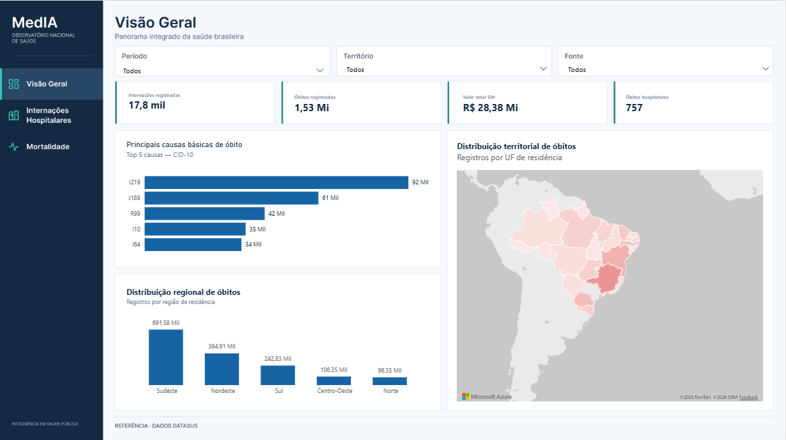 -->

#### Componentes e interpretação — Tela 01

**Objetivo:** oferecer panorama executivo do recorte de dados integrado, sem afirmar que SIH e SIM possuem a mesma abrangência temporal e territorial.

##### Função de cada filtro da Visão Geral

A **seleção de Período** usa os atributos de ano e mês da `gold_dim_tempo`: nas internações corresponde à **competência administrativa** e, na mortalidade, à data de ocorrência **somente quando o relacionamento temporal estiver ativo e validado**. A seleção múltipla não amplia automaticamente a cobertura da fonte. O filtro **Território** usa a Unidade da Federação de residência, não necessariamente o local onde houve atendimento ou óbito. O campo **Fonte** identifica registros do sistema hospitalar ou de mortalidade, mas deve evitar apagar cards de outra fonte sem explicação do contexto.

##### Cards

| Card (título amigável) | Medida observada | Interpretação | Fonte | Ressalva |
|---|---|---|---|---|
| **Internações registradas** | `[Total_de_AIHs]` / `Card_AIHs_HTML` | Soma da quantidade de AIHs no contexto | SIH | Não equivale a pessoas únicas |
| **Óbitos registrados** | `[Total_de_Óbitos]` | Soma de óbitos presentes no SIM | SIM | Abrangência e definição diferentes do óbito SIH |
| **Valor total SIH** | `[Valor_Total_SIH]` | Soma dos valores administrativos das AIHs | SIH | Não é custo assistencial integral |
| **Óbitos hospitalares SIH** | `[Óbitos_Hospitalares_SIH]` | Soma dos indicadores de desfecho de óbito no SIH | SIH | Não é o total de óbitos do SIM |

**Exemplos observados:** 17,8 mil internações, 1,53 Mi óbitos SIM, R$ 28,38 Mi no SIH e 757 óbitos SIH. Os números dependem do recorte da tela e do estado das cargas.

##### Gráficos

| Visual | Como interpretar | Medida/eixo | Interação |
|---|---|---|---|
| **Principais causas básicas de óbito** | Ranking dos cinco CID-10 com maior quantidade de óbitos | CID causa básica + `[Total_de_Óbitos]` | Passar mouse revela descrição; clicar pode cruzar filtros, se habilitado |
| **Distribuição regional de óbitos** | Soma dos óbitos por macrorregião de residência | Região + `[Total_de_Óbitos]` | Seleção por região, com relacionamento geográfico válido |
| **Distribuição territorial de óbitos** | Concentração de eventos por UF de residência | UF + `[Total_de_Óbitos]` | Hover e seleção territorial; legenda informa métrica |

**Atenção:** não chamar gráfico de óbitos por região de “internações por região”. Não inferir taxas apenas a partir de contagens absolutas.


##### Filtros da página

- **Período:** ano/mês, com nome amigável. Deve selecionar a competência no SIH e o mês da **data de óbito** no SIM, desde que os vínculos sejam comprovados.
- **Território:** UF de residência, respeitando a correspondência entre as dimensões e cada fato.
- **Fonte:** SIH/SIM somente se a interação fizer sentido para os indicadores; não deixar um seletor comum ocultar resultados de uma fonte sem explicação.

### Tela 02 — Internações Hospitalares
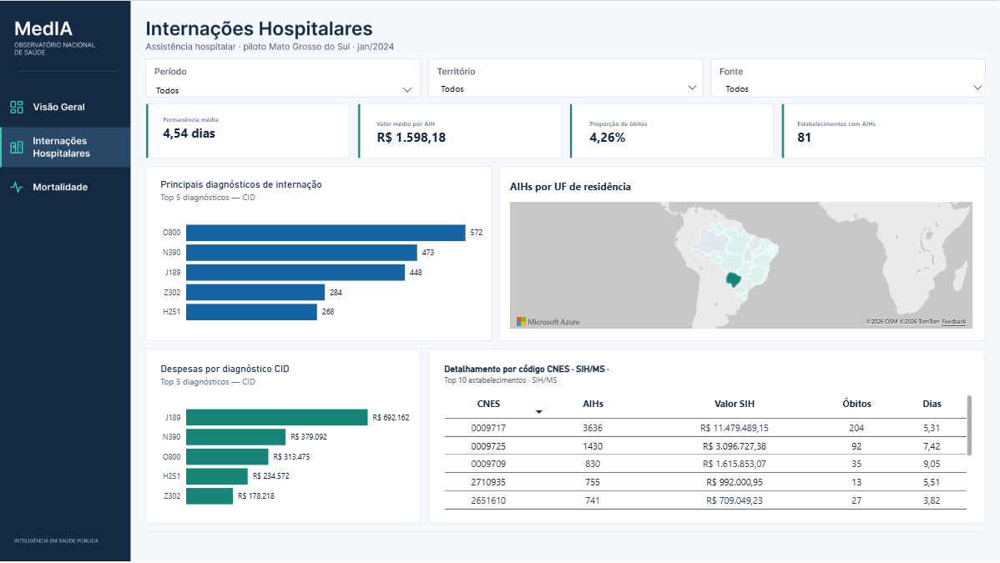


> **Captura da Tela 02 — Internações Hospitalares (pendente).** Adicione o arquivo `imagens/tela_02_internacoes.png` e habilite o Markdown abaixo. A descrição funcional completa está documentada independentemente da imagem.
>
<!--  -->

#### Componentes e interpretação — Tela 02

**Objetivo:** explicar volume, permanência, valores e perfil das internações SIH/SUS no recorte disponível.

##### Função dos filtros em Internações Hospitalares

O **Período** restringe a competência das Autorizações de Internação Hospitalar disponíveis na fato; o **Território** representa a Unidade da Federação de residência do registro. A fonte é o **Sistema de Informações Hospitalares do Sistema Único de Saúde**. Os mesmos recortes devem afetar permanência, valor médio, diagnósticos e a tabela de estabelecimentos quando as interações estão configuradas.

##### Cards finais (sem repetir os totais da Visão Geral)

| Card | Medida | Pergunta respondida | Exemplo da captura |
|---|---|---|---|
| **Permanência média** | `[Permanência_Média_SIH]` | Quantos dias em média por AIH? | 4,54 dias |
| **Valor médio por AIH** | `[Valor_Médio_por_AIH]` | Qual o valor SIH médio registrado por AIH? | R$ 1.598,18 |
| **Proporção de óbitos** | `[%_Óbitos_Hospitalares]` | Qual a parcela bruta de AIHs com óbito registrado? | 4,26% |
| **Estabelecimentos com AIHs** | `[Total_de_Estabelecimentos]` | Em quantos códigos CNES há AIHs carregadas? | 81 |

**Cautelas:** média calculada com ponderação pelas AIHs; óbitos por AIH **não** são taxa de mortalidade hospitalar ajustada; CNES distintos com AIH **não são** total de estabelecimentos existentes em CNES.

##### Gráficos e tabela de detalhe

| Visual | Campo principal | Regra e utilidade | Tooltip / formato |
|---|---|---|---|
| **Principais diagnósticos de internação** | `cid_codigo`, `[Total_de_AIHs]` | Top 5 por volume de AIHs; identifica diagnósticos frequentes | Exibir nome completo a partir do catálogo CID-10, preservando CID curto nas barras |
| **Despesas por diagnóstico CID** | `cid_codigo`, `[Valor_Total_SIH]` | Top 5 por valor SIH; **não** replicar ranking das AIHs | Valores em reais com R$; descrição correspondente ao código |
| **Distribuição territorial** *(quando inserida nessa página)* | UF de residência, AIHs ou valor SIH | Explora localização da atividade hospitalar | O título deve indicar **internações**, não óbitos, se essa for a métrica |
| **Detalhamento por código CNES** | `cnes_estabelecimento` + medidas | Mostra estabelecimentos **presentes nas AIHs** | Colunas CNES, AIHs, Valor SIH, Óbitos, Dias; verificar se “Dias” é média e rotular corretamente |

**Tabela CNES atual:** a captura mostra códigos (ex.: `0009717`), AIHs, Valor SIH, Óbitos e Dias. Ordenação por AIHs decrescentes e Top 10, se aplicável. O código CNES deve ser tratado como **texto**, preservando zeros à esquerda. Valores financeiros devem estar em moeda brasileira.


**Campo Dias:** nas capturas aparece o mesmo conceito da permanência média (ex.: 5,31). A documentação só deve rotulá-lo como *Permanência média (dias)* depois de verificar a medida vinculada, em vez de assumir que seja soma de dias.

##### Filtros

- **Período:** competência SIH efetivamente materializada.
- **Território:** residência; especificar claramente se em algum visual for utilizado local do hospital (ocorrência/oferta).
- **Fonte:** SIH fixa, quando não houver segunda fonte nessa página.

### Tela 03 — Mortalidade

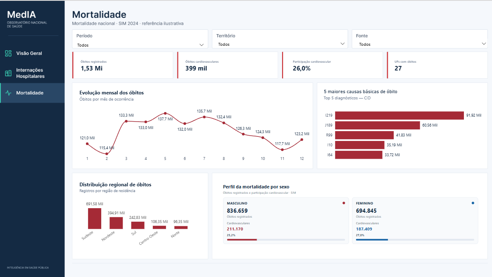

#### Componentes e interpretação — Tela 03

**Objetivo:** demonstrar volume, causas, distribuição temporal e características dos óbitos do SIM.

##### Função dos filtros em Mortalidade

O **Período** deve usar o mês de ocorrência do evento registrado no **Sistema de Informações sobre Mortalidade**; o arquivo anual não limita as análises a uma única data, desde que a dimensão temporal e a fato estejam conectadas pela data correta. O **Território** se refere à Unidade da Federação de residência, e não necessariamente ao local do óbito. A fonte principal da página é o próprio Sistema de Informações sobre Mortalidade.

##### Cards

| Card | Medida | Significado | Exemplo da tela |
|---|---|---|---|
| **Óbitos registrados** | `[Total_de_Óbitos]` | Quantidade de óbitos SIM no recorte | 1,53 Mi |
| **Óbitos cardiovasculares** | `[Óbitos_Cardiovasculares]` | Óbitos classificados como cardiovasculares pela regra CID adotada | ~399 mil |
| **Participação cardiovascular** | `[Percentual_Óbitos_Cardiovasculares]` | Óbitos cardiovasculares / óbitos registrados | ~26% |
| **UFs com óbitos** | `[UFs_Com_Óbitos]` | Contagem de UFs com eventos no recorte | 27 |

**Importante:** se o DAX devolve `0,26`, o card precisa mostrar `26,0%` (formatação). **0,26 não significa 0,26%.**

##### Visuais

| Visual | O que responde | Medida e contexto |
|---|---|---|
| **Evolução mensal dos óbitos** | Como variam os óbitos por mês de ocorrência em 2024? | `mes` ordenado cronologicamente e `[Total_de_Óbitos]` |
| **5 maiores causas básicas de óbito** | Quais CIDs concentram maior volume? | Causa básica CID-10 + `[Total_de_Óbitos]` com Top 5 |
| **Distribuição regional de óbitos** | Quais macrorregiões de residência possuem mais eventos absolutos? | `regiao_nome` + `[Total_de_Óbitos]` |
| **Perfil da mortalidade por sexo (HTML)** | Como se dividem os óbitos por sexo e a participação cardiovascular em cada grupo? | Total de óbitos por sexo; óbitos cardiovasculares; proporção dentro de cada grupo |


**Perfil por sexo:** em captura de desenvolvimento havia ~836.659 óbitos masculinos e ~694.845 femininos, com percentuais cardiovasculares distintos. Esses valores devem ser lidos no contexto do painel e não como totais definitivos. A nomenclatura de categorias e o tratamento de sexo ignorado/não informado devem ser explicitados se existentes.

##### Filtros

- **Período:** ano e mês da **ocorrência do óbito** (validar dimensão de tempo versus fato).
- **Território:** UF de residência, com filtro cruzado correto.
- **Fonte:** SIM fixa, caso só haja dados dessa fonte.

#### Tooltip CID-10

A experiência desejada é manter `J189` no eixo curto, mas exibir **“Pneumonia não especificada”** no mouse. A medida de tooltip precisa recuperar a descrição **do CID da barra corrente**. Não se deve apenas colocar `FIRST(cid_descricao)` de outra tabela no tooltip: pode repetir uma descrição errada para todos os códigos quando o filtro não propaga à dimensão.

O catálogo de doenças importado possui: `cid_codigo`, `cid_descricao`, `cid_rotulo`, `grupo`, `tipo`, `capitulo`. Uma única descrição por código deve ser garantida e os relacionamentos devem ser auditados. Consulte as seções **8 — Medidas DAX** e **7 — Modelo dimensional** deste mesmo README.

#### Funcionalidade dos segmentadores

| Controle | Comportamento pretendido | Limitação / regra |
|---|---|---|
| **Período** | Expandir ano → selecionar meses; selecionar múltiplos; limpar / selecionar tudo | Dropdown nativo pode sobrepor visuais ao abrir e mostra resumos técnicos; custom visual exige área própria |
| **Território** | Selecionar uma ou várias UFs por residência | Não aplicar automaticamente a UF do estabelecimento como se fosse residência |
| **Fonte** | Identificação SIH/SIM e, quando fizer sentido, seleção | Evitar que a escolha SIH esvazie card do SIM sem sinalização |
| **Cross-filter** | Clique em barra/elemento contextualiza demais visuais | Só quando as relações e o comportamento de interação estão validados |
| **Resetar filtros** | Remover seleções de forma previsível | Bookmark não deve restaurar dados/seleções indevidamente |

#### Convenções visuais e de unidades

- **mil** = mil unidades; **Mi** = milhão/milhões na documentação abreviada dos cards (por exemplo, 1,53 Mi = aproximadamente 1,53 milhão).
- `R$` = valores em reais brasileiros, com duas casas decimais quando adequado.
- `4,54 dias` = média de dias por AIH (não soma de todos os dias).
- Percentuais são frações multiplicadas por 100 na formatação (`0,0426` → `4,26%`).
- Cards HTML **apresentam** medidas: não são a fonte de verdade das regras DAX.

---


### Mapeamento detalhado dos elementos exibidos nos dashboards

> **Como ler este mapeamento:** o inventário abaixo associa os **títulos dos elementos das três telas** às medidas e colunas documentadas na seção 8. Distingue (a) **cálculo de negócio**, (b) **visual de apresentação**, (c) **pergunta analítica** e (d) **restrições de leitura**. As fórmulas numéricas são **regras de referência**, não uma extração automática do DAX instalado no arquivo `MedIa.pbix`. As imagens citadas ao final deste README são **caminhos para arquivos externos**, não imagens incorporadas ao Markdown entregue. Por isso o mapeamento descreve os visuais conhecidos no projeto, sem certificar a posição em pixels nem configurações não verificadas no relatório.

#### 10.A — Como um card chega ao número exibido

O percurso técnico é o mesmo para todos os indicadores: **dado oficial → Bronze (arquivo de origem) → Silver (normalização) → Gold (fato analítica) → medida DAX numérica → medida HTML ou visual nativo → filtro aplicado pelo usuário**. A etapa HTML só transforma o *modo de exibir*: não acrescenta registros, não recalcula o indicador e não se torna uma fonte adicional.

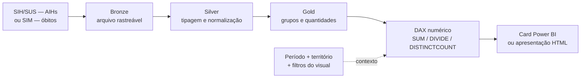

**O significado de 'medida' é diferente do significado de 'card':** `[Total_de_AIHs]` é uma expressão DAX que retorna uma quantidade; `Card_AIHs_HTML` é uma expressão que lê essa quantidade e devolve texto/HTML; o **card** é o bloco visual da interface que recebe a medida HTML. Se o número estiver incorreto, é preciso investigar a **origem, a regra de negócio e os relacionamentos**, não apenas a formatação do HTML.

**Exemplo de rastreabilidade — 17,8 mil internações:** a Gold armazena vários grupos, cada qual com `quantidade_aih`. `SUM(quantidade_aih)` recupera, no contexto filtrado, por exemplo, **17.755 AIHs**; o card arredonda apenas para exibir **17,8 mil**. Contar linhas da fato não produziria necessariamente 17.755, porque uma linha pode resumir mais de uma autorização. Esse indicador **não informa pacientes únicos**.

#### 10.B — Tela 01: Visão Geral | Mapeamento card a card

A página combina **fontes diferentes**: o **Sistema de Informações Hospitalares do SUS** para produção hospitalar e o **Sistema de Informações sobre Mortalidade** para óbitos da população. Seu propósito é proporcionar um **resumo executivo**, não comparar diretamente universos que podem ter períodos e geografias distintos.

| ID e card na tela | Medida de negócio → medida visual | O que está sendo calculado / regra | Por que o card existe | Como explicar o número na apresentação |
|---|---|---|---|---|
| **VG-01 — Internações registradas** | `[Total_de_AIHs]` → `Card_AIHs_HTML` | **Soma** de `gold_fato_internacoes[quantidade_aih]` nos filtros ativos. | Indica volume administrativo da atividade hospitalar registrada no SIH. | “Há aproximadamente **17,8 mil autorizações de internação** no recorte exibido; não significa 17,8 mil pessoas distintas.” |
| **VG-02 — Óbitos registrados** | `[Total_de_Óbitos]` → `Card_Total_Obitos_HTML` | **Soma** de `gold_fato_mortalidade[quantidade_obitos]`. | Mostra dimensão absoluta da mortalidade registrada no SIM, independentemente da base de internações. | “**1,53 Mi** representa cerca de 1,53 milhão de óbitos do SIM na captura, sujeito ao arquivo e filtros usados.” |
| **VG-03 — Valor total de internações** | `[Valor_Total_SIH]` → `Card_Valor_Total_SIH_HTML` | **Soma** de `gold_fato_internacoes[valor_total]`; apenas a apresentação divide por 1 milhão e prefixa `R$`. | Dimensiona os valores administrativos processados nas AIHs. | “**R$ 28,38 Mi** corresponde a valores registrados no SIH; não é estimativa de todo o custo real da assistência.” |
| **VG-04 — Óbitos hospitalares** | `[Óbitos_Hospitalares_SIH]` → `Card_Obitos_Hospitalares_HTML` | **Soma** de `gold_fato_internacoes[obitos_hospitalares]`, derivada do indicador de óbito das AIHs elegíveis. | Mostra desfechos hospitalares dentro do universo de autorizações. | “**757** é a quantidade de registros hospitalares com desfecho de óbito no recorte da captura, não o total nacional do SIM.” |

**Justificativa da coexistência de VG-02 e VG-04:** os dois cards contêm a palavra “óbitos”, mas **não medem a mesma população**. O SIM registra eventos de mortalidade e a causa básica; o SIH registra desfechos em autorizações hospitalares. Não subtrair nem somar os valores entre si como se fossem categorias complementares; a diferença é de fonte, abrangência, metodologia e período.

**Conferência do exemplo:** `757 / 17.755 ≈ 4,26%` é compatível com a proporção bruta exibida na página de Internações para a **mesma seleção SIH**. A proporção só é válida se numerador e denominador forem calculados sobre AIHs comparáveis e se o tratamento de informações ausentes for validado.

##### Visuais analíticos da Visão Geral

| Elemento visual | Configuração analítica de referência | Que pergunta responde? | Por que foi incluído / cuidado de interpretação |
|---|---|---|---|
| **VG-G01 — Principais causas básicas de óbito** | Barras: `gold_fato_mortalidade[cid_codigo]` ou dimensão CID + `[Total_de_Óbitos]`; ranking **Top 5 pelo total de óbitos**, ordenação decrescente. Tooltip: `[Descricao_CID_mortalidade]`. | “Quais causas básicas codificadas concentram mais óbitos?” | Permite sair da contagem geral e identificar condições frequentes; CID é **causa básica da DO**, não diagnóstico de AIH. |
| **VG-G02 — Distribuição regional de óbitos** | Região de **residência** via dimensão geográfica + `[Total_de_Óbitos]`. | “Em quais macrorregiões reside a maior quantidade de pessoas que foram a óbito?” | Mostra concentração absoluta dos registros. Regiões populosas tendem a ter totais maiores; não é comparação de risco sem população. |
| **VG-G03 — Distribuição territorial de óbitos** | Unidade da Federação de **residência** + `[Total_de_Óbitos]`; no mapa, valor ou intensidade deve representar a contagem. | “Como os óbitos registrados se distribuem entre as UFs?” | Permite localizar o fenômeno e filtrar outros gráficos, se a interação estiver habilitada. **Residência ≠ local de ocorrência do óbito**. |

**Leitura orientada da página:** primeiro apresente os quatro totais e informe a origem de cada um; em seguida, use as causas CID para mostrar **o que está associado ao evento** e os gráficos geográficos para mostrar **onde residiam as pessoas**. O Top 5 não expressa prevalência de doenças na população e o mapa de contagens não equivale a uma taxa por 100 mil habitantes.

#### 10.C — Tela 02: Internações Hospitalares | Mapeamento card a card

Esta página utiliza o **SIH/SUS** e investiga **eficiência descritiva, volume financeiro, resultados administrativos e unidades hospitalares**. Os quatro cards devem compartilhar o contexto territorial e de competência. Aqui a unidade básica é a **AIH**, e não o paciente.

| ID e card na tela | Medida de negócio → medida visual | Regra de cálculo (na seleção) | Por que foi incluído | Interpretação e limites |
|---|---|---|---|---|
| **IH-01 — Permanência média** | `[Permanência_Média_SIH]` → `Card_Permanencia_HTML` | `SUM(total_dias_permanencia) / [Total_de_AIHs]`, usando `DIVIDE()`. | Quantifica o tempo médio de permanência por autorização e auxilia a comparar perfis de internação. | **4,54 dias** significa média de dias por AIH, **não** que todas duraram esse período. É média ponderada: não calcular `AVERAGE()` da duração média de linhas Gold. |
| **IH-02 — Valor médio por AIH** | `[Valor_Médio_por_AIH]` → `Card_Valor_Medio_AIH_HTML` | `[Valor_Total_SIH] / [Total_de_AIHs]`, com `DIVIDE()`. | Torna o valor administrativo comparável a quantidades de AIHs, além do total financeiro. | **R$ 1.598,18/AIH** na captura, não o preço de tratamento clínico nem gasto por pessoa única. |
| **IH-03 — Proporção de óbitos** | `[%_Óbitos_Hospitalares]` → `Card_Percentual_Obitos_HTML` | `[Óbitos_Hospitalares_SIH] / [Total_de_AIHs]`, formatado como `%`. | Relaciona desfechos hospitalares ao volume de internações, evitando interpretar só o número bruto. | **4,26%** representa proporção **bruta** de autorizações com óbito; não é letalidade ajustada nem probabilidade clínica. Validar registros sem indicador de desfecho. |
| **IH-04 — Estabelecimentos com AIHs** | `[Total_de_Estabelecimentos]` → `Card_Estabelecimentos_HTML` | `DISTINCTCOUNT(cnes_estabelecimento)` sobre CNES não vazios **na fato SIH**. | Mostra quantos estabelecimentos diferentes produziram AIHs no recorte carregado. | **81** estabelecimentos com AIHs na captura; **não** corresponde aos **5.598** cadastros ST obtidos na Bronze do CNES do piloto. |

##### Detalhamento dos gráficos e da tabela de Internações

| ID e elemento | Campos, medida e critério | Por que o visual existe | Como apresentar e validar |
|---|---|---|---|
| **IH-G01 — Principais diagnósticos de internação** | Eixo: `cid_codigo` do **diagnóstico principal SIH**; valor: `[Total_de_AIHs]`; filtro **Top 5 por `[Total_de_AIHs]`**. | Identificar os diagnósticos com maior volume de autorizações, ajudando a caracterizar o perfil de produção hospitalar. | Citar **código e nome** (tooltip `[Descricao_CID_Tooltip]`). Não converter quantidade de AIHs em incidência da doença. |
| **IH-G02 — Despesas por diagnóstico CID** | Eixo: `cid_codigo`; valor: `[Valor_Total_SIH]`; filtro **Top 5 por valor total**, independente de IH-G01. | Revelar quais diagnósticos somam maiores valores administrativos, que podem ser diferentes dos mais frequentes. | Mostrar `R$` e esclarecer: **despesa registrada no SIH**, não custo total do hospital nem custo individual. A soma depende do contexto e da classificação CID da AIH. |
| **IH-G03 — Distribuição territorial das internações**, quando presente | Unidade da Federação **de residência** + `[Total_de_AIHs]`, ou `[Valor_Total_SIH]` se o título indicar valor. | Apresentar concentração geográfica da produção associada à residência. | Fixar a métrica no título/legenda; **nunca** rotular o mapa como mortalidade se a série for SIH. O piloto MS 01/2024 não suporta inferência nacional. |
| **IH-T01 — Detalhamento por CNES** | Linha: `cnes_estabelecimento`; colunas esperadas: `[Total_de_AIHs]`, `[Valor_Total_SIH]`, `[Óbitos_Hospitalares_SIH]` e `[Permanência_Média_SIH]` **se “Dias” for média**. | Permitir verificar quais estabelecimentos aparecem com mais AIHs e comparar volume, valores e permanência **no próprio SIH**. | Se o ranking for Top 10, declarar “10 estabelecimentos por volume de AIHs”. CNES como texto, p.ex. `0009717`; o total da tabela deve respeitar filtros e a ordenação precisa ser explícita. |

**Por que os dois rankings por CID não devem ser iguais por construção:** IH-G01 ordena por **quantidade** de AIHs; IH-G02 por **soma financeira**. Um diagnóstico com menor frequência pode concentrar valores maiores por AIH. Copiar o Top 5 do primeiro gráfico para o segundo produziria uma análise financeira enviesada.

**Por que a coluna “Dias” da tabela CNES merece atenção:** se ela usar `SUM(total_dias_permanencia)`, o resultado é **total acumulado de dias**; se usar `[Permanência_Média_SIH]`, é **média de dias por AIH**. São perguntas diferentes, portanto a documentação e o título precisam corresponder **à medida efetivamente usada**. A captura, isoladamente, não confirma a fórmula vinculada à coluna.

**Exemplo para apresentação:** “O painel mostra, para AIHs do recorte disponível, duração média de **4,54 dias**, valor administrativo médio de **R$ 1.598,18**, proporção bruta de **4,26%** de AIHs com óbito e **81** estabelecimentos com AIHs. Em seguida, investigamos **quais diagnósticos** geram mais volume/valor e **quais CNES** aparecem na produção.” Esses valores são históricos, não resultados dinâmicos certificados.

#### 10.D — Tela 03: Mortalidade | Mapeamento card a card

A página de Mortalidade usa o **Sistema de Informações sobre Mortalidade (SIM)**. O evento analisado é o **óbito**; suas dimensões descrevem mês de ocorrência, causa básica CID-10, sexo e território **de residência**. Os cartões cardiovasculares são **subconjuntos** do total e dependem de classificação CID explícita.

| ID e card na tela | Medida de negócio → medida visual | Como o DAX chega ao resultado | Por que existe | O que o valor representa |
|---|---|---|---|---|
| **MO-01 — Óbitos registrados** | `[Total_de_Óbitos]` → `Card_Mortalidade_Obitos_HTML` | `SUM(gold_fato_mortalidade[quantidade_obitos])`. | Apresentar a referência numérica central da página e denominador das proporções. | **1,53 Mi** ≈ 1,53 milhão de óbitos do SIM no exemplo de tela. Não misturar com óbitos hospitalares SIH. |
| **MO-02 — Óbitos cardiovasculares** | `[Óbitos_Cardiovasculares]` → `Card_Mortalidade_Cardiovasculares_HTML` | `CALCULATE([Total_de_Óbitos], doenca_cardiovascular = TRUE())`, conforme marcador da fato. | Isolar um grupo relevante de causas básicas para análise focal. | **~399 mil** óbitos com CID classificado como cardiovascular no exemplo. Checar exatamente quais códigos entram no marcador. |
| **MO-03 — Participação cardiovascular** | `[Percentual_Óbitos_Cardiovasculares]` → `Card_Mortalidade_Percentual_HTML` | `[Óbitos_Cardiovasculares] / [Total_de_Óbitos]`, via `DIVIDE()`, com máscara percentual. | Mostrar o peso **relativo** das causas cardiovasculares entre as mortes registradas. | **~26%** significa aproximadamente 26 de cada 100 óbitos do SIM na seleção. **Não é taxa de mortalidade da população**. |
| **MO-04 — UFs com óbitos** | `[UFs_Com_Óbitos]` → `Card_Mortalidade_UFs_HTML` | `DISTINCTCOUNT(uf_residencia)` sobre registros SIM não vazios do recorte. | Dar transparência à abrangência geográfica efetivamente observada na consulta. | **27** UFs aparecem com registros no exemplo; não garante que todas as competências ou causas estejam completas. |

**Atenção especial ao percentual cardiovascular:** a medida numérica pode retornar `0,26`; o Power BI precisa formatá-la como **26%**. Apresentar `0,26%` reduziria o valor exibido em cem vezes. Além disso, o **marcador cardiovascular** deve ser validado: classificar genericamente o capítulo `I` da CID-10 corresponde às doenças do aparelho circulatório, e o projeto deve documentar quando essa for a definição utilizada.

##### Detalhamento dos visuais de Mortalidade

| ID e elemento | Campos e regra do visual | Motivo da escolha | Leitura correta e testes |
|---|---|---|---|
| **MO-G01 — Evolução mensal dos óbitos** | Eixo: **mês da data de ocorrência** (`ano_mes`/`mes`); valor: `[Total_de_Óbitos]`; ordenar pelo número do mês, não pelo texto do rótulo. | Identifica sazonalidade aparente e variações mensais na contagem de óbitos. | Janeiro–dezembro de 2024 devem usar a **data do evento**, não 12 repetições do total do arquivo anual `DO24OPEN`. Verificar o relacionamento temporal ativo. |
| **MO-G02 — 5 maiores causas básicas de óbito** | `cid_codigo` da **causa básica SIM** + `[Total_de_Óbitos]`, ordenação decrescente e filtro Top 5 por essa medida. | Identificar as causas de maior frequência entre os registros de óbito. | Explicar o CID no tooltip `[Descricao_CID_mortalidade]`. Um código pode ser clínico/externo; a interpretação depende do CID-10 registrado. |
| **MO-G03 — Distribuição regional de óbitos** | Região de **residência** + `[Total_de_Óbitos]`. | Facilitar comparação geográfica em níveis agregados, reduzindo a complexidade de 27 UFs. | Valores absolutos, não risco; a região precisa filtrar a fato via UF sem duplicar os registros. |
| **MO-G04 — Perfil da mortalidade por sexo** | Medida de apresentação `Perfil_Mortalidade_HTML` lê **total**, **cardiovasculares** e **participação cardiovascular** separadamente para sexo masculino e feminino, conforme códigos da fonte. | Comparar o **perfil de causas** em grupos de sexo, sem depender apenas do total de óbitos. | Valores aproximados mostrados no desenvolvimento: **836.659** masculinos e **694.845** femininos. Verificar códigos `1`/`2` e categoria ignorada/não informada; proporção de cada sexo usa **o próprio total daquele sexo** como denominador. |

**Como funciona o card composto de perfil por sexo, por dentro:**

1. A medida `[Total_de_Óbitos]` é recalculada com filtro de **sexo masculino** e de **sexo feminino** separadamente; por isso aparecem dois totais.
2. `[Óbitos_Cardiovasculares]` é recalculada nos mesmos dois grupos, mantendo os filtros de período e território.
3. `DIVIDE(óbitos cardiovasculares do sexo, total de óbitos do mesmo sexo)` calcula **a participação intragrupo**. Exemplo: “27% dos óbitos masculinos registrados tiveram causa cardiovascular” é diferente de “27% de todas as mortes foram masculinas”.
4. `Perfil_Mortalidade_HTML` **formata e organiza** os seis números; não substitui as medidas DAX por sexo nem cria novos registros.
5. Óbitos com **sexo ignorado, indefinido ou ausente**, se existentes, não devem ser alocados automaticamente em masculino/feminino; a soma desses dois grupos pode ser **menor que o total da página**.

**Sobre a comparação anual/mensal:** o fato de a extração SIM usar um arquivo **anual** não impede série mensal, pois o mês deve vir da **data do óbito**. Por outro lado, se a Gold ou a ligação temporal estiverem inadequadas, o gráfico pode ser enganoso mesmo exibindo 12 meses. A validação técnica deve comparar `SUM(quantidade_obitos)` por `ano_mes` com o total da seleção, contemplando datas desconhecidas separadamente.

#### 10.E — Relação entre medida, campo, camada Gold e visual (matriz de auditoria)

| Medida ou recurso | Origem da Gold / campo | Onde é usado | Tipo / regra | Verificação essencial |
|---|---|---|---|---|
| `[Total_de_AIHs]` | `gold_fato_internacoes.quantidade_aih` | VG-01, IH-G01, IH-T01 e denominadores IH | `SUM` aditiva | Conciliar com total de AIHs elegíveis na Silver, **não** contar linhas agrupadas. |
| `[Valor_Total_SIH]` | `gold_fato_internacoes.valor_total` | VG-03, IH-G02, IH-T01, IH-02 (numerador) | `SUM` monetária | Verificar moeda, nulos, duplicação de registros e mesmo filtro. |
| `[Óbitos_Hospitalares_SIH]` | `gold_fato_internacoes.obitos_hospitalares` | VG-04, IH-T01, IH-03 (numerador) | `SUM` condicionada à regra SIH | Validar consolidação de `indicador_obito` e casos ausentes. |
| `[Permanência_Média_SIH]` | `total_dias_permanencia` + `quantidade_aih` | IH-01; IH-T01, **se usada** | `DIVIDE(SUM(dias), SUM(AIHs))` | Verificar se o denominador inclui somente permanência válida. |
| `[Valor_Médio_por_AIH]` | Medidas SIH anteriores | IH-02 | `DIVIDE(valor SIH, AIHs)` | Evitar média simples de valores médios por grupo. |
| `[%_Óbitos_Hospitalares]` | Medidas SIH anteriores | IH-03 | `DIVIDE(óbitos SIH, AIHs)` | Tratar como **proporção bruta**, não taxa ajustada. |
| `[Total_de_Estabelecimentos]` | `gold_fato_internacoes.cnes_estabelecimento` | IH-04, contexto CNES | `DISTINCTCOUNT` de código não vazio | Não confundir com todos os cadastros do CNES; preservar zeros. |
| `[Total_de_Óbitos]` | `gold_fato_mortalidade.quantidade_obitos` | VG-02, VG-G01/G02/G03, MO-01/G01/G02/G03/G04 | `SUM` aditiva | Conciliar com eventos SIM filtrados pela **data da ocorrência**. |
| `[Óbitos_Cardiovasculares]` | Fato SIM + `doenca_cardiovascular` | MO-02, MO-G04 | `CALCULATE` com filtro CID/classificação | Reproduzir seleção de códigos da regra institucional. |
| `[Percentual_Óbitos_Cardiovasculares]` | Duas medidas SIM anteriores | MO-03, MO-G04 | `DIVIDE(cardio, total)` | Exibir 0,26 como 26%; não chamar “por 100 mil”. |
| `[UFs_Com_Óbitos]` | `gold_fato_mortalidade.uf_residencia` | MO-04 | `DISTINCTCOUNT` | É UFs **com eventos na seleção**, não prova de cobertura completa. |
| `[Descricao_CID_Tooltip]` | Código CID SIH + `tabela_cid10` | IH-G01, IH-G02 | `SELECTEDVALUE` → `LOOKUPVALUE` | Cada barra precisa mostrar **seu** CID correto, não “Primeiro”. |
| `[Descricao_CID_mortalidade]` | Código CID SIM + `tabela_cid10` | VG-G01, MO-G02 | `SELECTEDVALUE` → `LOOKUPVALUE` | Diferenciar causa básica SIM de diagnóstico principal SIH. |
| `Perfil_Mortalidade_HTML` | Medidas SIM + `sexo_codigo` | MO-G04 | `CALCULATE` por sexo e `DIVIDE` intragrupo | Tratar sexo não informado e manter período/UF da seleção. |
| `Card_*_HTML` | Medida numérica correspondente | 12 posições de cards entre páginas | `FORMAT` + HTML | Verificar que arredondamento **não alterou** cálculo nem escondeu `BLANK()`. |

#### 10.F — Filtros: o que modificam e por que existem

| Filtro/interação | Páginas | Efeito pretendido nos cálculos | Motivo de negócio e teste de qualidade |
|---|---|---|---|
| **Período — ano e mês** | Geral, Internações e Mortalidade | Filtrar SIH por **competência administrativa** e SIM por **mês da ocorrência do óbito**, conforme vínculo validado. | Permitir análise temporal contextualizada. **Não** usar o mês do nome de um arquivo anual SIM como substituto da data do óbito. |
| **Território — UF de residência** | Todas | Restringir fatos pela residência registrada e suas chaves geográficas. | Comparabilidade territorial de residência. Não trocar silenciosamente pela localização do hospital. |
| **Fonte — SIH/SIM** | Geral, quando funcional; nas páginas temáticas pode ser apenas rótulo | Identificar qual sistema abastece cada visual; não deve zerar ou ocultar resultados de outra fonte sem aviso. | Evitar mistura de denominadores e confusão entre óbitos SIM e desfechos SIH. |
| **Clique em barra / mapa** | Gráficos com interação configurada | Aplicar seleção aos visuais relacionados por meio do modelo; pode ser filtro ou realce, dependendo da configuração. | Viabilizar exploração. **Testar**, não presumir que todos os componentes HTML respondem a cliques. |
| **Top 5 / Top 10** | Rankings de diagnósticos e CNES | Restringir categorias pelo indicador especificado; não altera como a medida é somada dentro de cada categoria. | Destacar principais contribuições. É necessário declarar **Top por quê?** (AIHs, valor SIH ou óbitos). |
| **Limpar filtros / bookmark** | Todas | Restaurar recorte esperado sem deixar filtros invisíveis. | Reprodutibilidade de uma mesma análise em demonstrações e revisões. |

**Regra de cobertura transversal:** selecionar período/UF não carregado deve resultar em **“sem dados para esta seleção” ou vazio sinalizado**, conforme estratégia do relatório; **zero** só é justificável se a fonte estiver coberta e nenhum evento elegível tiver ocorrido. A presença de 27 UFs no SIM não garante presença de 27 UFs no SIH.

#### 10.G — Interpretação dos números mostrados nas capturas (valores históricos)

| Número apresentado | Onde aparece | Leitura correta | Não concluir que… |
|---|---|---|---|
| **17,8 mil** | Visão Geral / Internações | Aproximadamente 17.755 AIHs SIH no contexto capturado. | …são pacientes únicos ou todas as internações do Brasil. |
| **1,53 Mi** | Visão Geral / Mortalidade | Aproximadamente 1,53 milhão de óbitos no SIM na versão capturada. | …são exclusivamente óbitos hospitalares do SIH. |
| **R$ 28,38 Mi** | Visão Geral | Soma de valores administrativos das AIHs carregadas. | …é o custo completo do atendimento no SUS. |
| **757** | Visão Geral | Óbitos hospitalares identificados nos registros SIH. | …é o mesmo indicador do SIM. |
| **4,54 dias** | Internações | Média de permanência por AIH, com regra de elegibilidade a conferir. | …todos os internados permaneceram 4,54 dias. |
| **R$ 1.598,18** | Internações | Valor administrativo SIH médio por autorização. | …é o preço real de cada procedimento ou o gasto por paciente. |
| **4,26%** | Internações | Proporção bruta de AIHs com desfecho de óbito. | …é mortalidade ajustada por caso, hospital ou faixa etária. |
| **81** | Internações | Quantidade de códigos CNES distintos com AIHs no recorte. | …é o total de estabelecimentos cadastrados no CNES. |
| **~399 mil / ~26%** | Mortalidade | Subconjunto cardiovascular e sua participação entre os óbitos SIM. | …representa incidência cardiovascular ou óbitos por 100 mil habitantes. |
| **27** | Mortalidade | UFs distintas com óbitos presentes nos dados filtrados. | …todos os períodos e atributos estão igualmente completos. |
| **836.659 / 694.845** | Perfil por sexo (captura histórica) | Óbitos masculinos e femininos exibidos naquela seleção. | …a soma cobre necessariamente sexo ignorado ou não informado. |

**Não misturar execuções:** o README reúne exemplos observados em capturas e execuções de diferentes momentos. Em particular, um total **~1,53 Mi** na tela não pode ser declarado automaticamente igual a um total Gold histórico de **1.045.379** linhas/registros relatado em outra execução. Antes de apresentar números como atuais, conferir **mesma tabela, mesma carga, mesma granularidade, mesmos filtros e mesma data de extração**. O mapeamento acima explica **o significado do número**, sem certificar que a captura represente o estado mais recente do modelo.

#### 10.H — Roteiro objetivo para apresentar os três dashboards

**Visão Geral.** “O MedIA integra fontes públicas com finalidades diferentes. Os cards hospitalares vêm do SIH/SUS: total de autorizações, valores administrativos e óbitos associados às AIHs. O card de óbitos registrados vem do SIM. Depois dos totais, os gráficos de causa e distribuição territorial ajudam a caracterizar **quais causas** aparecem e **onde residem** as pessoas.”

**Internações.** “Nesta tela saímos do volume bruto para o perfil da internação: permanência média, valor médio por AIH e proporção de óbitos registrados. Também sabemos quantos estabelecimentos efetivamente aparecem nas AIHs. Os rankings por CID mostram dois recortes diferentes — frequência e valores — e a tabela por CNES detalha os resultados.”

**Mortalidade.** “Aqui analisamos exclusivamente eventos do SIM. O total de óbitos é separado em causas cardiovasculares, sua participação e UFs representadas. A evolução temporal mostra o **mês em que ocorreu o óbito**; os rankings mostram causas básicas; a distribuição regional e o perfil por sexo descrevem **onde e em quais grupos** aparecem os eventos.”

**Mensagem conclusiva:** os três painéis não são apenas figuras: cada card possui uma **origem identificada**, uma **fórmula explicável**, um **objetivo de análise** e um **limite de interpretação**. É essa rastreabilidade que permite defender tecnicamente os resultados do MedIA.

---


## 11. Glossário e abreviações


| Termo | Significado no MedIA | Nota de interpretação |
|---|---|---|
| **MedIA** | Observatório Nacional de Saúde, nome do produto | Painel e pipeline analítico |
| **SUS** | Sistema Único de Saúde | Contexto da saúde pública brasileira |
| **DATASUS** | Departamento de Informática do Sistema Único de Saúde | Disponibiliza fontes SIH, SIM, CNES e outras |
| **SIH/SUS** | Sistema de Informações Hospitalares do Sistema Único de Saúde | Base de AIHs e valores administrativos |
| **AIH** | Autorização de Internação Hospitalar | Registro administrativo; não equivale diretamente a paciente único |
| **RD** | Arquivo SIH do tipo reduzido, ex. `RDMS2401` | UF e competência embutidas no nome do arquivo |
| **SIM** | Sistema de Informações sobre Mortalidade | Óbitos e causas básicas; não confundir com óbito SIH |
| **DO** | Declaração de Óbito | Documentação de evento de mortalidade; também identifica arquivos SIM |
| **DO24OPEN** | Exemplo de arquivo do SIM de 2024 | Fonte anual nacional no piloto |
| **CNES** | Cadastro Nacional de Estabelecimentos de Saúde | Identifica estabelecimentos; não presume existência de AIH |
| **ST** | Arquivo/categoria de estabelecimentos no CNES | Cadastro de estabelecimentos por competência |
| **LT** | Arquivo/categoria de leitos no CNES | Uma unidade CNES pode ter várias linhas por tipo de leito |
| **CID-10** | Classificação Estatística Internacional de Doenças e Problemas Relacionados à Saúde — 10ª revisão | Códigos de doenças, diagnósticos e causas de óbito |
| **CID** | Código da classificação de doenças | `J189` = pneumonia não especificada |
| **Causa básica** | Doença ou circunstância inicial associada à cadeia causal da morte, conforme registro SIM | Não confundir com todos os diagnósticos registrados |
| **UF** | Unidade da Federação | 27 UFs no Brasil |
| **MS** | Mato Grosso do Sul | UF inicial do piloto SIH |
| **IBGE** | Instituto Brasileiro de Geografia e Estatística | Padronização de regiões e localidades |
| **CNES com AIHs** | Estabelecimento identificado na fato SIH | Não é total de estabelecimentos cadastrados |
| **Competência** | Período administrativo de referência da produção SIH | Pode diferir de data da ocorrência clínica |
| **Ano/mês** | Chave `AAAAMM`, ex. `202401` | Chave de período, não texto de exibição |
| **KPI** | Indicador-chave de desempenho (*Key Performance Indicator*) | Cards resumidos no dashboard |
| **Top 5 / Top N** | Cinco / N categorias mais relevantes por medida | Ranking deve indicar o critério escolhido |
| **Mi** | Milhão(ões), abreviação visual dos cards | `1,53 Mi` significa ~1.530.000; não confundir com *mebibyte* |
| **mil** | Mil unidades | `399 mil` ~399.000 |
| **R$** | Real brasileiro | Moeda dos indicadores SIH |
| **DAX** | Expressões de Análise de Dados (*Data Analysis Expressions*) | Linguagem de medidas e colunas no Power BI |
| **Power Query / M** | Linguagem de ingestão/transformação no Power BI | Foi usada para importar e tratar o catálogo CID-10 |
| **HTML Content Secure** | Visual para renderizar HTML controlado | Apresenta medidas; não é substituto pleno de um slicer funcional |
| **Slicer / segmentador** | Filtro interativo do Power BI | Seleção de período, território e fonte |
| **Tooltip** | Dica de ferramentas ao passar o mouse | Mostra diagnóstico por extenso e medidas |
| **Star Schema** | Modelo dimensional em estrela | Dimensões filtram fatos; simplifica consultas analíticas |
| **Fato** | Tabela de eventos/medidas | Fato pode ser previamente **agregada** |
| **Dimensão** | Tabela descritiva usada para contexto e filtros | UF, tempo, CID, localidade |
| **Grão / granularidade** | O que exatamente uma linha representa | Essencial para evitar contagem incorreta |
| **1:N** | Um para muitos | Relação típica dimensão → fato |
| **DirectQuery** | Consulta remota na fonte durante interação | Depende de credenciais e desempenho da origem |
| **Direct Lake** | Consulta otimizada de dados Delta no Fabric pelo mecanismo compatível | Não confundir com DirectQuery ou Import |
| **Importar** | Dados copiados para o modelo Power BI | Tabela CID foi importada nesse modo |
| **Modelo composto** | Modelo que combina fontes/modos, inclusive modelo semântico remoto | Requer cuidado com credenciais e relacionamentos |
| **Bronze** | Dados brutos preservados | Rastreabilidade de arquivos e origem |
| **Silver** | Dados limpos, tipados e padronizados | Regras de qualidade e chaves |
| **Gold** | Modelo analítico para BI | Fatos, dimensões, indicadores e controles |
| **OneLake** | Lago de dados unificado do Fabric | Armazena arquivos/tabelas e permite atalhos |
| **Lakehouse** | Repositório de arquivos + tabelas no Fabric | Pode expor tabelas Delta a ferramentas analíticas |
| **Delta Lake** | Formato transacional de tabelas no lake | Persistência das tabelas Gold |
| **Parquet** | Formato de dados colunar | Usado no processamento/armazenamento intermediário |
| **DBC / DBF** | Formatos de arquivos originários/convertidos do DATASUS | Conversão ocorre antes do uso analítico |
| **FTP** | Protocolo de transferência de arquivos | Usado em downloads DATASUS/CNES |
| **Gateway** | Ponte de acesso do serviço a fontes que precisam de rota local/privada | CSV local pode exigir; fonte Web pública usa ligação cloud |
| **Data Quality (DQ)** | Verificações de integridade, completude e coerência | Controlar erros, alertas e reconciliação |
| **Card** | Bloco de KPI com título e valor | Contextualizado por filtros |
| **AIHs com óbito / percentual de óbitos** | Relação entre desfechos SIH e AIHs elegíveis | Indicador bruto; requer documentação do denominador |
| **Óbitos cardiovasculares** | Óbitos com CID definido como cardiovascular na regra adotada | Parcela do total SIM, não taxa populacional |

---


## 12. Qualidade, validação e cobertura


#### O que verificar em cada indicador

| Indicador | Verificação mínima | Erro comum evitado |
|---|---|---|
| Total AIHs | Somar `quantidade_aih` no contexto e confrontar com Silver | Contar linhas agregadas |
| Valor total SIH | Somar `valor_total` e comparar a mesma seleção de competência/UF | Somar tabelas duplicadas após join |
| Permanência média | Comparar total de dias / AIHs elegíveis | Média simples de médias por grupo |
| Óbitos hospitalares | Validar `indicador_obito` elegível e soma Gold | Misturar com evento SIM |
| Estabelecimentos com AIHs | Contar CNES distintos **não vazios** | Confundir com cadastro CNES |
| Total de óbitos SIM | Somar `quantidade_obitos`; confrontar com total Silver | Contar grupos em vez de óbitos |
| Cardiovasculares | Checar o conjunto CID e a proporção pelo total SIM | Tratar `0,26` como `0,26%` |
| UFs com óbitos | Contar UFs de residência **presentes na seleção** | Confundir número de UFs com cobertura plena de datas |
| CID tooltip | Conferir `O800`, `N390`, `J189`, `Z302`, `H251` separadamente | Repetição do primeiro CID para todas as barras |

#### Cobertura e interpretação

- **SIH:** último recorte validado é MS, janeiro de 2024. Não rotular como Brasil inteiro.
- **SIM:** arquivo anual nacional 2024; os eventos podem ser distribuídos por mês da data do óbito.
- A dimensão `gold_dim_tempo` pode mostrar 12 meses por causa do SIM, ainda que o SIH tenha dados de apenas um deles.
- O filtro que inclui janeiro, fevereiro e março **não fabrica dados ausentes**; deve respeitar cada fonte.
- Registrar se uma seleção de período retorna **vazio** por ausência de carga ou **zero** de eventos com cobertura comprovada.
- Indicadores com bases diferentes devem identificar contexto e fonte, sobretudo na Visão Geral.

#### Validações do modelo relacional

- As chaves de dimensão são únicas e não nulas no lado **1**.
- Mesma tipagem nos pares de chaves (`cid_codigo` texto, UF código coerente, `ano_mes` numérico ou equivalência controlada).
- Relacionamentos ativos 1:N, preferencialmente unidirecionais.
- Tabela importada `tabela_cid10` não cria caminhos paralelos ambíguos junto de `gold_dim_cid`.
- **Código municipal DATASUS de 6 dígitos** não é relacionado silenciosamente com IBGE de 7 dígitos.
- Dimensões de região e UF não somam valores por caminhos diferentes simultaneamente.
- Não unir `gold_indicadores_uf_ano` diretamente a detalhe mensal de forma que replique totais anuais.

#### Testes visuais e funcionais

| Teste | Resultado esperado |
|---|---|
| Filtro Período = jan/2024 | SIH do piloto responde com registros |
| Filtro Período = mar/2024 | SIH só responde se esta competência tiver sido realmente carregada |
| Filtro SIM por mês | Série mensal e total SIM acompanham mês da ocorrência, se relação validada |
| Filtro Território = MS | Todos os visuais com residência UF refletem MS e não outra UF |
| Top 5 AIHs | Ordenação pelo volume `[Total_de_AIHs]` |
| Top 5 financeiro | Ordenação independente por `[Valor_Total_SIH]` |
| Tooltip do CID J189 | Descrição “Pneumonia não especificada” |
| Card percentual cardiovascular | Exibe 26% quando DAX é 0,26, não 0,26% |
| Tabela por CNES | Preserva zeros à esquerda; total de AIHs bate com o contexto da página |
| Publicação Power BI Service | Ligações cloud e credenciais configuradas; visuais carregam no navegador |
| Visual HTML | Sem barra interna indesejada, sombra/borda duplicadas ou corte do valor |

#### Histórico de DQ

Um ciclo de verificação do projeto apresentou **24 regras**, com **21 aprovadas**, **3 alertas** e **0 reprovadas**. Esses são os resultados de uma **execução histórica**, não substituem a validação atual das tabelas no momento de publicação.

Alertas de maturidade identificados ao longo do desenvolvimento: cobertura SIH incompleta (um mês do piloto), CNES ainda sem integração analítica consolidada em certas versões e questões operacionais de capacidade/orquestração no Fabric Trial.

#### Pendências que devem constar em qualquer publicação externa

1. **Inventário de relacionamentos ativos** extraído do PBIX / modelo semântico, com cardinalidades e direções efetivas.
2. **Exportação real das fórmulas DAX** para substituir as versões de referência por expressões verificadas.
3. **Matriz de cobertura** por fonte, UF, ano e mês no estado atual das tabelas.
4. **Validação de data SIM** — confirmação de correspondência entre `ano_mes` e mês da ocorrência.
5. **Normalização do dicionário CID-10** dentro da dimensão única, evitando caminho ambíguo do catálogo externo.
6. **Governança de versões** para não misturar contagens de execuções diferentes.

#### Evidências recomendadas

Guardar capturas dos cartões filtrados, resultados SQL por fonte/competência, capturas da janela de relacionamentos, diagnóstico de erro Power BI Service e inventário de fontes/credenciais (sem registrar segredos, tokens ou senhas).

#### Princípio de comunicação

Todo gráfico deve responder **o que foi medido, qual fonte, qual recorte, qual unidade, e quais limites de interpretação**. Os indicadores não substituem avaliação clínica/epidemiológica aprofundada e não devem ser usados para inferir incidência, letalidade ou risco ajustado sem denominador e método apropriados.

---


## 13. Limitações, pendências e próximos passos

A documentação acima descreve o **processo realizado**, as decisões de engenharia e o papel dos elementos visuais. Não deve ser lida como um certificado de que todos os dados nacionais e competências históricas já foram carregados.

| Item | Situação a tratar |
|---|---|
| **Cobertura SIH nacional/multianual** | Expandir e reconciliar as competências e UFs, sem confundir catálogo identificado com dados processados |
| **CNES Silver/Gold** | Concluir a materialização e validar estabelecimentos/leitos, preservando o grão dos arquivos ST/LT |
| **Relacionamentos ativos** | Confirmar no PBIX as relações reais, cardinalidade, direção, chaves e caminhos de filtro |
| **Medidas DAX instaladas** | Conferir as fórmulas no modelo semântico contra as fórmulas de referência documentadas |
| **CID-10** | Preferir uma dimensão única, com código/descrição, evitando múltiplos caminhos de filtro |
| **Cobertura de SIH e SIM** | Documentar a matriz fonte × ano × mês × UF e mostrar explicitamente onde não há carga |
| **Publicação do relatório** | Verificar credenciais cloud, atualização e consulta de todos os visuais no Power BI Service |
| **Orquestração Fabric** | Avaliar disponibilidade de capacidade e sessões; erros de capacidade não devem ser confundidos com erros de dados |
| **Taxas populacionais** | Não calcular taxas por 100 mil sem denominadores oficiais e ano/UF compatíveis |

### Etapa futura: documentação de notebooks

Os notebooks e a operação dos pipelines foram **intencionalmente deixados para o final**, conforme o escopo acordado. Quando essa fase for documentada, este próprio README poderá receber uma seção adicional contendo papéis dos notebooks, parâmetros, ordem de execução, tratamento de erros, logs, reprocessamento incremental e procedimentos de restauração.

---

**Critério de qualidade documental:** qualquer valor ou relacionamento registrado como “observado” deve ser conferido no ambiente a que ele se refere. Exemplo de captura histórica não é contrato de cobertura futura. As descrições aqui apresentadas preservam a diferença entre fato de internações (SIH), fato de mortalidade (SIM), tabela de cobertura e tabelas de cadastro CNES.


### Inclusão das imagens de tela no repositório

As imagens devem ser incluídas na pasta `imagens/`. Quando disponíveis, as referências Markdown comentadas nas seções **Tela 01**, **Tela 02** e **Tela 03** podem ser ativadas. **A documentação permanece concentrada em um único `README.md`.**
