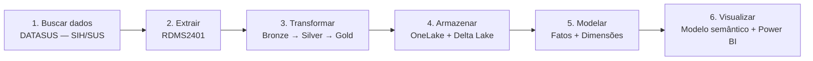
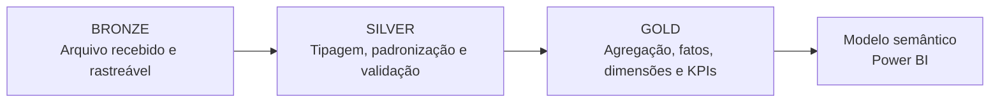
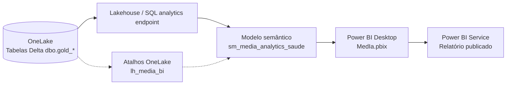
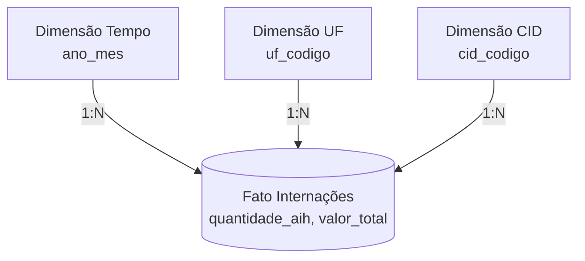
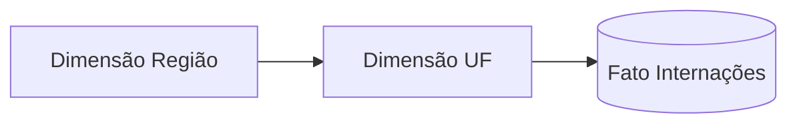
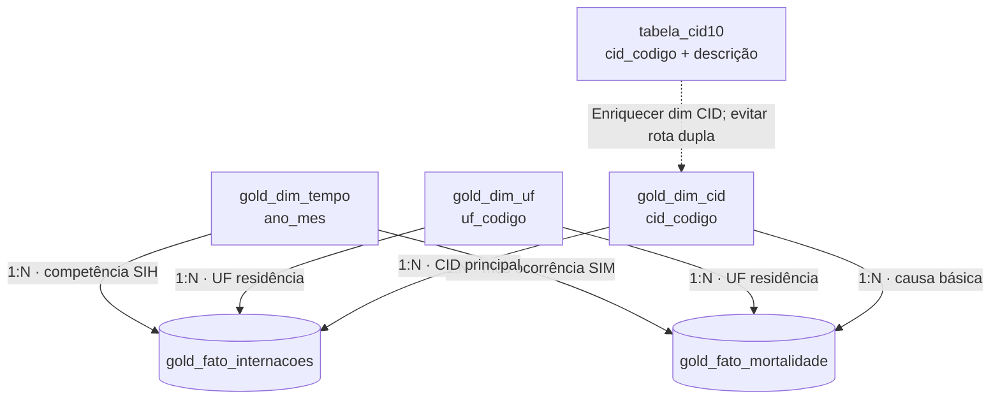

# MedIA — Observatório Nacional de Saúde

**Roadmap técnico e roteiro de apresentação | Engenharia de Dados · Microsoft Fabric · Power BI**  
**Revisão:** 22 de outubro de 2026 · **Situação:** projeto em desenvolvimento, com cargas e visuais em fase de evolução

O **MedIA** é uma solução de engenharia de dados e Business Intelligence que utiliza dados públicos de saúde para transformar arquivos operacionais do SUS em informações estruturadas, medidas analíticas e dashboards interativos. Este **único `README.md`** documenta a história técnica do projeto **na mesma ordem da apresentação**: fonte dos dados → extração → transformação → armazenamento → modelagem dimensional → fatos e dimensões → medidas → telas e funcionalidades → limitações.

> **Recorte usado para demonstrar o processo inteiro:** **SIH/SUS — Mato Grosso do Sul — competência janeiro de 2024**, arquivo reduzido `RDMS2401`. Essa escolha permite seguir uma base específica da origem ao card **Internações registradas**. O **SIM nacional de 2024** será introduzido ao explicar a página Mortalidade. Não apresentaremos o piloto SIH como cobertura nacional ou plurianual concluída.

---

## Roteiro da apresentação — visão geral

| Ordem | Etapa | O que explicar ao público | Tempo sugerido |
|---:|---|---|---:|
| 1 | [Abertura e problema](#1-abertura-o-que-é-o-media-e-qual-problema-resolve) | Para que o MedIA foi criado | 1 min |
| 2 | [Busca e extração — uma base real](#2-busca-e-extração-dos-dados-exemplo-com-o-sihsus) | Origem DATASUS, arquivo `RDMS2401`, campos e coleta | 3 min |
| 3 | [Transformação — Bronze, Silver e Gold](#3-transformação-dos-dados-o-que-acontece-com-o-arquivo) | Tipagem, limpeza, padronização, regras e agregações | 3 min |
| 4 | [Armazenamento e disponibilização](#4-armazenamento-e-carregamento-onelake-lakehouse-dbo-e-modelo-semântico) | Onde ficam arquivos, tabelas `dbo`, endpoint SQL e Power BI | 3 min |
| 5 | [Por que Star Schema?](#5-modelagem-dimensional-por-que-star-schema-e-não-snowflake-schema) | Fato vs. dimensão, estrela vs. floco de neve e critérios | 2 min |
| 6 | [Criação e relacionamentos](#6-criação-das-dimensões-fatos-e-relacionamentos) | Como definimos granularidade, chaves e `1:N` | 3 min |
| 7 | [Medidas e regras de negócio](#7-medidas-dax-por-que-cada-indicador-foi-criado) | Por que usar soma, `DIVIDE`, `DISTINCTCOUNT` e HTML | 2 min |
| 8 | [Tela 1 — Visão Geral](#8-tela-1--visão-geral) | Filtros, quatro cards, rankings e território | 3 min |
| 9 | [Tela 2 — Internações](#9-tela-2--internações-hospitalares) | Médias, desfechos, diagnósticos, custos e CNES | 3 min |
| 10 | [Tela 3 — Mortalidade](#10-tela-3--mortalidade) | SIM, cardiovasculares, séries temporais e perfil por sexo | 3 min |
| 11 | [Qualidade, limitações e fechamento](#11-qualidade-cobertura-limitações-e-próximas-etapas) | O que os dados permitem concluir e próximos passos | 2 min |

**Duração sugerida:** aproximadamente 28 minutos; adapte reduzindo os exemplos, caso a apresentação seja mais curta. A documentação de código de cada notebook fica para uma etapa posterior — **não há tutoriais de execução de notebooks neste README**.

### Fluxo resumido para projetar na apresentação



**Ideia central para comunicar:** o painel é o resultado final de um processo de engenharia de dados. As validações e a modelagem tornam os indicadores utilizáveis; o Power BI apenas os apresenta e permite explorá-los.

---

## 1. Abertura: o que é o MedIA e qual problema resolve?

Os sistemas públicos de saúde produzem grandes quantidades de registros, mas esses registros geralmente são distribuídos em arquivos e estruturas voltados ao processamento administrativo, não à consulta direta por analistas ou usuários finais. Para entender quantidades, valores, diagnósticos e distribuição territorial, é necessário **integrar, tratar, padronizar e modelar os dados**.

O MedIA foi desenvolvido para percorrer essa cadeia com tecnologias de engenharia de dados:

- **Origem:** DATASUS, IBGE e catálogo CID-10.
- **Processamento:** Python e Apache Spark/PySpark no Microsoft Fabric.
- **Persistência:** OneLake, Lakehouse, arquivos Parquet e tabelas Delta Lake.
- **Camada analítica:** tabelas fato/dimensão, relacionamentos e medidas DAX.
- **Consumo:** relatório Power BI com cards, filtros, rankings, séries, mapas, tabelas e tooltips.

> **Fala sugerida:** “O problema não era apenas criar um dashboard. O desafio foi transformar arquivos públicos, de diferentes estruturas e granularidades, em dados confiáveis para análise. Vou acompanhar uma base do SIH/SUS desde sua origem até o indicador visual, mostrando cada decisão técnica.”

---

## 2. Busca e extração dos dados: exemplo com o SIH/SUS

### 2.1. De onde vem a informação?

A fonte escolhida para acompanhar o fluxo é o **SIH/SUS — Sistema de Informações Hospitalares do Sistema Único de Saúde**, disponibilizado pelo **DATASUS**, órgão de informação e tecnologia em saúde vinculado ao Ministério da Saúde.

O SIH trabalha com dados derivados de **AIHs — Autorizações de Internação Hospitalar**. Uma AIH é um registro administrativo relacionado à internação autorizada e ao processamento dos procedimentos hospitalares no SUS; **não deve ser tratada automaticamente como paciente único**.

**Arquivo usado no piloto:** `RDMS2401`.

| Parte | Significado |
|---|---|
| `RD` | Arquivo reduzido de AIHs do SIH |
| `MS` | Mato Grosso do Sul |
| `24` | Ano de competência 2024 |
| `01` | Mês de competência janeiro |

**O que procuramos nesse arquivo?** Os campos necessários para responder às perguntas da página de internações: competência, município de residência, código do estabelecimento (`CNES`), diagnóstico principal (`CID-10`), valor administrativo da AIH, dias de permanência e indicador de óbito hospitalar.

**Por que começar pela busca e análise do arquivo?** Porque o nome, a abrangência, a competência e as colunas determinam o que o dashboard poderá afirmar. Um arquivo de MS/janeiro não pode sustentar conclusões sobre todas as UFs e todos os meses do Brasil.

### 2.2. Como fizemos a extração?

O fluxo implementado utiliza **Python no Microsoft Fabric**, com recursos de **PySUS** quando disponíveis para localizar/obter arquivos DATASUS, além de mecanismos alternativos de acesso direto a arquivos públicos quando necessário. Para o piloto SIH, trabalhamos com o arquivo `RDMS2401.parquet` preparado para leitura analítica pelo Spark.

A extração segue esta sequência lógica:

1. Identificar o sistema `SIH`, a UF `MS` e a competência `2024-01`.
2. Localizar o arquivo RD correspondente no DATASUS e verificar sua disponibilidade.
3. Realizar o download e converter/preparar o conteúdo para formato legível por Spark, quando necessário.
4. Armazenar o arquivo de entrada na área **Bronze** do OneLake com identificação de fonte, UF, ano e mês.
5. Registrar metadados para rastreabilidade: origem, competência, nome do arquivo, volume e situação do processamento.

**Exemplo do caminho lógico na Bronze** (a estrutura exata deve ser conferida na execução atual):

```text
lh_media_analytics
└── Files
    └── media
        └── bronze
            └── sih
                └── uf=MS
                    └── ano=2024
                        └── mes=01
                            └── RDMS2401.parquet
```

**Por que Parquet?** É um formato colunar eficiente para leitura analítica, compressão e seleção de colunas no Spark. No MedIA, ele permite trabalhar com registros extraídos sem precisar reabrir continuamente a origem pública.

**Importante:** os arquivos operacionais DATASUS podem ser originalmente disponibilizados em formatos como **DBC**. O Parquet é o formato preparado e utilizado no processamento do piloto; isso não significa que o arquivo publicado originalmente pelo DATASUS já fosse Parquet.

> **Fala sugerida:** “Escolhemos o SIH do Mato Grosso do Sul em janeiro de 2024. O arquivo RD contém os registros administrativos de internação. Depois de identificá-lo e extraí-lo, armazenamos uma representação preparada em Parquet na camada Bronze do OneLake, preservando a competência e a origem. A partir daqui, deixamos de depender da consulta direta ao portal para realizar cada análise.”

### 2.3. E as outras fontes?

A apresentação técnica detalhada usa **somente SIH** como exemplo de extração. Para contextualizar as outras telas, basta citar:

| Fonte complementar | Uso no MedIA | Situação/ressalva |
|---|---|---|
| **SIM — Sistema de Informações sobre Mortalidade** | Total, causas e perfil dos óbitos | Arquivo anual nacional `DO24OPEN`, referência 2024 |
| **CNES — Cadastro Nacional de Estabelecimentos de Saúde** | Cadastro de estabelecimentos e leitos | Arquivos `STMS2401` e `LTMS2401` obtidos na Bronze para o piloto; integração analítica em evolução |
| **IBGE** | Nomes/códigos de UF, região e municípios | Referência para padronização territorial |
| **CID-10** | Descrição em português dos diagnósticos e causas | Catálogo de enriquecimento da apresentação |

---

## 3. Transformação dos dados: o que acontece com o arquivo?

Depois da extração, o arquivo não deve ir diretamente para os gráficos. Precisamos padronizar o conteúdo, eliminar inconsistências conhecidas, assegurar tipos corretos e criar uma estrutura de análise. Para isso utilizamos a arquitetura **Medallion: Bronze → Silver → Gold**.



### 3.1. Bronze — manter o que recebemos

**Objetivo:** preservar a entrada e permitir rastrear o processamento. Uma transformação incorreta não deve obrigar a baixar novamente a fonte, se o arquivo original ou sua representação fiel estiver disponível.

No exemplo SIH, guardamos o `RDMS2401.parquet` e a competência da carga. O trabalho da Bronze é **receber e preservar**, não calcular indicadores finais.

**Entrada:** arquivo do SIH. **Saída:** arquivo rastreável no diretório `Files/media/bronze/sih/...`.

### 3.2. Silver — limpar e padronizar

**Objetivo:** tornar o dado tecnicamente consistente para uso posterior. Na Silver do SIH, a tabela observada é `dbo.silver_sih_internacoes`.

Tratamentos usados ou definidos para a carga SIH:

| Transformação | Exemplo | Justificativa |
|---|---|---|
| **Tipos de dados** | Valores e dias como números; datas/competências com tipo adequado | Somar e comparar corretamente |
| **Competência** | Ano `2024`, mês `1` | Evitar interpretação da competência como data de extração |
| **CID-10** | `J18.9` → `J189` e maiúsculas | Relacionar diagnósticos a uma dimensão única |
| **CNES** | `0009709` permanece texto | Preservar zeros à esquerda |
| **Município/UF** | Normalizar município DATASUS e derivar UF de residência | Associar registros à dimensão geográfica |
| **Indicador de óbito** | Tratar `1`, `0` e não informado como estados distintos | Evitar converter ausência de dado em zero |
| **Metadados** | Fonte, ano, mês e identificação da carga | Rastreabilidade e auditoria |

No projeto, o código de município DATASUS pode usar **seis posições**, enquanto identificadores municipais do IBGE frequentemente usam **sete**. Não foi presumida equivalência automática sem uma regra de correspondência.

**Entrada:** Bronze SIH. **Saída:** tabela estruturada `dbo.silver_sih_internacoes`, com campos adequados para regras de negócio.

### 3.3. Gold — modelar dados para análise

A camada **Gold** não se limita a “limpar”. Ela reorganiza os dados conforme o modo como o usuário pergunta: **quantas internações? por mês? por CID? por UF? qual valor?**

No caso da SIH, os registros preparados na Silver são **agrupados** pelas dimensões relevantes, incluindo:

- UF e município de residência;
- ano e mês de competência;
- código CID principal;
- código CNES do estabelecimento.

Para cada combinação são agregados `quantidade_aih`, `valor_total`, `valor_uti`, `total_dias_permanencia` e `obitos_hospitalares`. Isso produz a fato `dbo.gold_fato_internacoes`.

**Ponto fundamental para a apresentação:** uma linha da Gold pode resumir **várias AIHs**. Portanto, contar linhas da Gold não informa o total de internações. O indicador utiliza `SUM(quantidade_aih)`.

### 3.4. Qualidade entre as camadas

Antes de disponibilizar a Gold, verificamos:

- presença dos campos obrigatórios, competência válida e geografia identificada;
- ausência de chaves essenciais inválidas, quando a regra exigir;
- unicidade das chaves das dimensões;
- reconciliação entre os registros elegíveis da Silver e a soma de `quantidade_aih` na Gold;
- distinção entre **sem dado carregado**, **zero observado** e **erro de execução**.

Houve execução histórica da rotina de qualidade com **24 verificações, 21 aprovadas, 3 alertas e nenhuma reprovação**. Esses números descrevem uma execução específica, não a garantia do estado atual; os alertas estavam ligados sobretudo a limitações de cobertura/integridade das cargas.

> **Fala sugerida:** “A Silver transforma o arquivo em uma estrutura consistente: códigos, datas, números e localização passam a seguir padrões. Na Gold, organizamos as informações em grupos analíticos, como mês, CID e hospital, e calculamos quantidades e valores. A principal preocupação é garantir que o total depois da transformação corresponda ao total válido da origem.”

---

## 4. Armazenamento e carregamento: OneLake, Lakehouse, `dbo` e modelo semântico

É importante separar **onde os dados são gravados** de **como são consultados**. O MedIA usa OneLake como armazenamento unificado e um Lakehouse do Microsoft Fabric como ambiente de arquivos e tabelas analíticas.

### 4.1. Onde ficam os arquivos e as tabelas?

```text
Microsoft Fabric / OneLake
└── lh_media_analytics                         ← Lakehouse de processamento
    ├── Files/
    │   └── media/
    │       ├── bronze/                        ← arquivos obtidos/preparados
    │       ├── silver/                        ← área técnica de processamento, quando usada
    │       ├── gold/                          ← área técnica, quando usada
    │       └── logs/                          ← manifestos/execuções
    └── Tables/
        └── dbo/
            ├── silver_sih_internacoes
            ├── silver_sim_obitos
            ├── gold_fato_internacoes
            ├── gold_fato_mortalidade
            ├── gold_dim_tempo
            ├── gold_dim_uf
            ├── gold_dim_cid
            ├── gold_dim_regiao
            ├── gold_dim_localidade
            ├── gold_indicadores_uf_ano
            └── gold_controle_cobertura
```

Essa árvore representa a **organização lógica identificada no projeto**. A presença e atualização de cada tabela devem ser verificadas no Lakehouse que será demonstrado.

| Elemento | Significado | Exemplo MedIA |
|---|---|---|
| **OneLake** | Camada de armazenamento unificado do Fabric | Armazena arquivos e tabelas do projeto |
| **Lakehouse** | Ambiente de dados com `Files` e `Tables` | `lh_media_analytics` |
| **Parquet** | Formato colunar de arquivo | `RDMS2401.parquet` na Bronze |
| **Delta Lake** | Formato de tabela com metadados e controle transacional | Tabelas Silver/Gold do Lakehouse |
| **`dbo`** | Esquema (namespace) das tabelas SQL | `dbo.gold_fato_internacoes` |
| **SQL analytics endpoint** | Interface de consulta T-SQL sobre tabelas Delta | `SELECT ... FROM dbo.gold_fato_internacoes` |
| **Modelo semântico** | Camada de relações, filtros e medidas de BI | `sm_media_analytics_saude` |

### 4.2. As estruturas `dbo.gold_*` são views?

**Não necessariamente — e, no fluxo implementado, as principais são tabelas Delta materializadas.** Isso é essencial para explicar corretamente na apresentação.

- O processamento Spark prepara DataFrames de Silver e Gold.
- A escrita em **Delta** materializa a tabela do Lakehouse, por exemplo `dbo.gold_fato_internacoes`.
- O Lakehouse disponibiliza a tabela automaticamente no **endpoint SQL**.
- O modelo semântico do Power BI utiliza essas tabelas para construir medidas e visuais.
- **Uma view SQL é outra possibilidade**, usada para encapsular consultas, mas sua existência não deve ser presumida só porque um objeto aparece sob `dbo`.

**Exemplo de gravação, apenas para ilustrar a ideia — não é o tutorial do notebook:**

```python
(
    gold_fato_internacoes.write
    .format("delta")
    .mode("overwrite")
    .saveAsTable("dbo.gold_fato_internacoes")
)
```

**Exemplo de consumo no endpoint SQL:**

```sql
SELECT
    ano_mes,
    cid_codigo,
    SUM(quantidade_aih) AS total_aihs
FROM dbo.gold_fato_internacoes
GROUP BY ano_mes, cid_codigo;
```

A consulta soma `quantidade_aih`, pois cada linha da fato já representa um grupo agregado. O endpoint SQL do Lakehouse é uma interface **de leitura** para essas tabelas; a gravação deve ocorrer por mecanismos próprios de processamento, como Spark.

### 4.3. Por que criamos também `lh_media_bi`?

O ambiente passou a utilizar dois Lakehouses relevantes:

- **`lh_media_analytics`:** processamento, Bronze, Silver e Gold.
- **`lh_media_bi`:** ambiente de disponibilização dos dados na área de trabalho **MedIA**, com **atalhos OneLake** para as tabelas da origem, quando configurados.

**Atalho OneLake** referencia dados da origem sem exigir uma cópia manual de cada tabela. A disponibilidade no SQL e no Power BI depende das permissões e da configuração efetiva dos atalhos.

### 4.4. Como o dado chega ao Power BI?



No Desktop, observou-se também um **modelo composto/misto**, porque a tabela de referência `tabela_cid10` foi importada para mostrar descrições dos diagnósticos enquanto outras consultas se conectavam ao modelo remoto. Após publicação, esse cenário exige credenciais e permissões corretas tanto para a fonte Web do CID-10 quanto para o modelo semântico de origem. **Publicar o PBIX não comprova, sozinho, que as conexões no serviço estejam funcionando.**

> **Fala sugerida:** “O OneLake guarda tanto os arquivos da extração quanto as tabelas analíticas. A diferença é que, em `Files`, preservamos arquivos, e em `Tables/dbo` materializamos tabelas Delta, prontas para SQL. O modelo semântico conecta essas tabelas às regras DAX e aos relatórios, sem exigir que o usuário conheça o formato dos arquivos.”

---

## 5. Modelagem dimensional: por que Star Schema e não Snowflake Schema?

### 5.1. O que é modelagem dimensional?

É uma organização voltada à **análise e agregação**, diferente de simplesmente reproduzir as tabelas operacionais da fonte. Os dados são divididos em dois grandes papéis:

- **Fatos:** registram eventos/quantidades/valores que queremos analisar, como AIHs, valores e óbitos.
- **Dimensões:** descrevem **quando, onde e o quê** foi registrado, como tempo, UF e CID.

**Exemplo:** o usuário pergunta: “Quantas internações relacionadas a pneumonia ocorreram na competência janeiro/2024 em MS?” A dimensão CID identifica o diagnóstico, a dimensão Tempo identifica a competência, a dimensão UF identifica o território e a fato SIH fornece a quantidade de AIHs.

### 5.2. Star Schema: esquema em estrela

O **Star Schema** coloca uma tabela fato no centro e estabelece relações, preferencialmente **um-para-muitos (1:N)**, com as dimensões que a descrevem.



**Por que priorizamos esse desenho para o Power BI?**

1. **Filtros compreensíveis:** Tempo, Território e CID filtram as métricas da fato.
2. **Caminhos de filtro mais curtos:** evita percorrer várias tabelas intermediárias em análises comuns.
3. **Menor risco de ambiguidade:** relações geralmente unidirecionais, da dimensão para a fato.
4. **Medidas reutilizáveis:** `[Total_de_AIHs]` responde automaticamente à seleção de UF, mês e CID.
5. **Modelagem amigável:** usuários do Power BI compreendem melhor o que é categoria e o que é indicador.

### 5.3. Snowflake Schema: esquema floco de neve

No **Snowflake Schema**, atributos de uma dimensão são distribuídos em outras dimensões relacionadas, criando cadeias. Por exemplo:



| Aspecto | Star Schema | Snowflake Schema |
|---|---|---|
| Organização | Dimensões conectadas diretamente às fatos | Algumas dimensões se conectam a outras dimensões |
| Leitura por quem cria gráficos | Normalmente mais simples | Exige entender cadeias e hierarquias |
| Relações e propagação dos filtros | Em geral, mais diretas | Podem envolver mais saltos |
| Repetição de atributos | Pode repetir o nome de região em cada UF | Normalização diminui repetição |
| Adequação ao MedIA | **Preferência para consumo analítico** | Útil para organização geográfica e manutenção de cadastros |

**Rigor técnico:** o MedIA **não precisa ser descrito como uma estrela 100% pura**. Existem tabelas `gold_dim_regiao`, `gold_dim_uf` e `gold_dim_localidade`, e algumas configurações podem formar relações do tipo floco de neve. A escolha defendida é **priorizar a estrutura em estrela na camada de consumo**, mantendo `regiao_nome` diretamente disponível em `gold_dim_uf` quando isso simplificar filtros e análises. O desenho efetivamente ativo precisa ser confirmado na Exibição de Modelo do PBIX.

> **Fala sugerida:** “Escolhemos priorizar Star Schema porque nosso uso é analítico: preciso filtrar fatos por tempo, território e diagnóstico com o menor número possível de caminhos. O Snowflake normaliza mais as dimensões, mas pode tornar a leitura e a propagação de filtros mais complexas. No MedIA há referências geográficas que podem ser normalizadas, por isso falo em modelo predominantemente dimensional em estrela, não em uma estrela absolutamente pura.”

---

## 6. Criação das dimensões, fatos e relacionamentos

### 6.1. Por que separar dimensão de fato?

**Dimensão:** responde perguntas de contexto. **Fato:** fornece as quantidades e valores medidos nesse contexto. Ao separar esses papéis evitamos repetir rótulos em cada linha da fato e organizamos os filtros do relatório.

| Tabela | Papel | Como foi definida / para que serve |
|---|---|---|
| `gold_fato_internacoes` | **Fato** | Grupos de AIHs do SIH por residência, competência, CID e CNES; soma de AIHs, valores, dias e óbitos SIH |
| `gold_fato_mortalidade` | **Fato** | Óbitos SIM agregados por residência, mês/ano do óbito, CID de causa básica e sexo |
| `gold_dim_tempo` | **Dimensão** | Um registro por competência `ano_mes`, com ano, mês e outros atributos temporais |
| `gold_dim_uf` | **Dimensão** | Código, sigla, nome e informações de região da UF |
| `gold_dim_cid` | **Dimensão** | Código CID-10 e atributos de classificação, como capítulo e marcador cardiovascular |
| `gold_dim_regiao` | **Dimensão auxiliar** | Referência às macrorregiões brasileiras |
| `gold_dim_localidade` | **Dimensão auxiliar** | Referência territorial municipal; correspondência de chaves exige validação |
| `tabela_cid10` | **Referência de descrição** | CSV com nome do diagnóstico; no futuro, idealmente incorporar a `gold_dim_cid` |
| `gold_indicadores_uf_ano` | **Resumo agregado** | Indicadores por UF/ano; grão diferente do detalhe mensal |
| `gold_controle_cobertura` | **Controle** | Fonte, ano, mês, UF, periodicidade e registros efetivamente carregados |

### 6.2. Primeiro definimos a granularidade

**Granularidade** é o significado de uma linha. A etapa de modelagem deve começar por ela, e não apenas pela escolha de nomes de tabelas.

- **Fato SIH:** cada linha representa um **grupo** por UF/município de residência, competência, CID e CNES. A quantidade real de AIHs no grupo está em `quantidade_aih`.
- **Fato SIM:** cada linha representa um **grupo de óbitos** por UF/município de residência, ano/mês de ocorrência, CID de causa básica e sexo. O peso do grupo está em `quantidade_obitos`.
- **Dimensão Tempo:** uma linha por `ano_mes` (por exemplo, `202401`).
- **Dimensão CID:** uma linha por `cid_codigo`, sem duplicações de chave.
- **Dimensão UF:** uma linha por código UF, com chave única.

Por isso **`COUNTROWS(gold_fato_internacoes)` não é o número de AIHs**, e `COUNTROWS(gold_fato_mortalidade)` não é o número de óbitos. As medidas devem somar seus respectivos pesos.

### 6.3. Como os relacionamentos fazem o filtro funcionar?

Um relacionamento estabelece a correspondência entre a chave única da dimensão (lado **1**) e a chave repetida da fato (lado **N**). Em um desenho típico, o filtro segue da dimensão para a fato.

**Diagrama lógico recomendado para análise, não inventário certificado do PBIX:**



**Relações e chaves a conferir no modelo atual:**

| Origem (lado 1) | Destino (lado N) | Chaves esperadas | Por quê? |
|---|---|---|---|
| Tempo | Internações | `ano_mes` → `ano_mes` | Filtrar competência SIH |
| Tempo | Mortalidade | `ano_mes` → `ano_mes` | Filtrar mês da **data do óbito**, se relacionamento configurado |
| UF | Internações | `uf_codigo` → `codigo_uf_ibge` | Filtrar UF de residência no SIH |
| UF | Mortalidade | `uf_codigo` → `codigo_uf_ibge` | Filtrar UF de residência no SIM |
| CID | Internações | `cid_codigo` → `cid_codigo` | Classificar diagnóstico principal |
| CID | Mortalidade | `cid_codigo` → `cid_codigo` | Classificar causa básica do óbito |

**Atenção:** o print do modelo mostrou uma combinação de dimensões, fatos e `tabela_cid10`, mas não permitiu identificar com segurança **todas as colunas de todas as linhas, seus estados ativos e as direções de filtro**. A tabela acima documenta a **estrutura lógica esperada**, não uma confirmação automática da configuração física.

**Erro que evitamos:** criar simultaneamente um caminho `gold_dim_cid → fato` e outro `tabela_cid10 → fato` que resulte em filtros concorrentes. O ideal futuro é enriquecer **uma dimensão CID única** e conectá-la às duas fatos.

### 6.4. Um exemplo para demonstrar na prática

1. Usuário seleciona **MS** em Território.
2. `gold_dim_uf` identifica o código territorial correspondente.
3. O relacionamento filtra `gold_fato_internacoes` para aquela UF de residência.
4. Usuário seleciona **janeiro/2024**.
5. `gold_dim_tempo` restringe a fato à competência `202401`.
6. `[Total_de_AIHs]` soma somente os grupos que permanecem no contexto filtrado.

**Exemplo CID:** selecionar `J189` restringe a análise ao diagnóstico “Pneumonia não especificada”, desde que a descrição tenha sido corretamente associada e a relação esteja válida.

> **Fala sugerida:** “A dimensão funciona como uma referência de filtro e a fato fornece o número. Essa separação explica por que o mesmo total de AIHs pode ser analisado por estado, mês ou doença sem criar uma tabela diferente para cada gráfico.”

---

## 7. Medidas DAX: por que cada indicador foi criado?

As medidas são fórmulas **DAX** calculadas dinamicamente conforme a seleção no relatório. A lógica analítica fica nas medidas numéricas; o HTML utilizado nos cards serve apenas à **formatação visual**.

> **Convenção:** as expressões abaixo descrevem a lógica e os campos observados no projeto; devem ser comparadas com a versão atual das medidas do PBIX antes de serem tratadas como código definitivo. Não substitua medidas publicadas sem verificar filtros de elegibilidade e campos nulos.

### 7.1. Medidas de internações — SIH

**Total de AIHs** — soma os registros representados pelos grupos da Gold; **não** conta linhas físicas.

```dax
Total_de_AIHs =
SUM('gold_fato_internacoes'[quantidade_aih])
```

**Valor total SIH** — soma o valor administrativo informado nas AIHs; **não representa necessariamente custo econômico integral da assistência**.

```dax
Valor_Total_SIH =
SUM('gold_fato_internacoes'[valor_total])
```

**Óbitos hospitalares SIH** — contabiliza o desfecho registrado no SIH; não equivale ao conjunto de óbitos de todo o SIM.

```dax
Óbitos_Hospitalares_SIH =
SUM('gold_fato_internacoes'[obitos_hospitalares])
```

**Permanência média SIH** — utiliza a soma de dias ponderada pela quantidade de AIHs, evitando a média simples das linhas agregadas.

```dax
Permanência_Média_SIH =
DIVIDE(
    SUM('gold_fato_internacoes'[total_dias_permanencia]),
    [Total_de_AIHs]
)
```

**Valor médio por AIH** — divide a soma dos valores pelo total de AIHs na mesma seleção.

```dax
Valor_Médio_por_AIH =
DIVIDE([Valor_Total_SIH], [Total_de_AIHs])
```

**Proporção bruta de óbitos hospitalares** — relaciona desfechos com a quantidade de AIHs. **Não é taxa ajustada por risco**.

```dax
%_Óbitos_Hospitalares =
DIVIDE([Óbitos_Hospitalares_SIH], [Total_de_AIHs])
```

**Estabelecimentos com AIHs** — conta códigos CNES distintos presentes nos registros de internação; **não é o número de estabelecimentos cadastrados no CNES**.

```dax
Total_de_Estabelecimentos =
CALCULATE(
    DISTINCTCOUNT('gold_fato_internacoes'[cnes_estabelecimento]),
    NOT ISBLANK('gold_fato_internacoes'[cnes_estabelecimento])
)
```

### 7.2. Medidas de mortalidade — SIM

**Óbitos registrados** — soma o peso de cada grupo da fato SIM.

```dax
Total_de_Óbitos =
SUM('gold_fato_mortalidade'[quantidade_obitos])
```

**Óbitos cardiovasculares** — seleciona grupos cuja causa básica está classificada pelo marcador cardiovascular. No processamento atual, a regra observada utiliza o capítulo `I` da CID-10.

```dax
Óbitos_Cardiovasculares =
CALCULATE(
    [Total_de_Óbitos],
    'gold_fato_mortalidade'[doenca_cardiovascular] = TRUE()
)
```

**Participação cardiovascular** — compara óbitos cardiovasculares ao total de óbitos no mesmo contexto.

```dax
Percentual_Óbitos_Cardiovasculares =
DIVIDE([Óbitos_Cardiovasculares], [Total_de_Óbitos])
```

> **Cuidados com percentuais:** um resultado numérico `0,26` significa uma fração de **26%** quando formatado como porcentagem; não significa `0,26%`. Sem denominador populacional, esta é uma **participação no total**, não uma taxa por 100 mil habitantes.

**UFs com óbitos** — quantifica as UFs de residência presentes no recorte.

```dax
UFs_Com_Óbitos =
CALCULATE(
    DISTINCTCOUNT('gold_fato_mortalidade'[uf_residencia]),
    NOT ISBLANK('gold_fato_mortalidade'[uf_residencia])
)
```

### 7.3. Por que usamos HTML nos cards e no perfil por sexo?

As medidas numéricas calculam as métricas. Outras medidas DAX geram HTML **somente para exibir** título, fonte, número abreviado, tipografia e cores com o padrão visual MedIA. Esse HTML é renderizado pelo visual **HTML Content Secure**.

- Um card HTML não substitui a medida numérica correspondente.
- O HTML Content Secure não atua, por si só, como segmentador completo de filtro entre os gráficos.
- A unidade exibida precisa ser correta: `17,8 mil`, `R$ 28,38 Mi`, `4,54 dias`, `4,26%`.
- O catálogo `tabela_cid10` foi usado para mostrar **a descrição correspondente ao código CID**, preferencialmente no tooltip sem alongar o eixo dos gráficos.

---

## 8. Tela 1 — Visão Geral

**Objetivo da tela:** abrir a apresentação com um resumo executivo dos conjuntos **SIH** e **SIM** disponíveis, mostrando volume de internações, óbitos, valores administrativos e distribuição das causas/territórios.

### 8.1. Cabeçalho e filtros

| Filtro | O que representa | Como deve ser demonstrado |
|---|---|---|
| **Período** | Ano e mês | Selecionar um ou mais meses disponíveis; no SIH é **competência**, no SIM é **mês do óbito**, quando o relacionamento está correto |
| **Território** | UF ou região de **residência** | Selecionar MS ou outra UF e explicar a diferença entre recorte estadual SIH e nacional SIM |
| **Fonte** | SIH ou SIM | Usar com cautela: fontes têm indicadores e coberturas diferentes; não esconder totais de outra fonte sem explicar |

**Observação de UX:** o filtro de Período pode apresentar Ano → Mês e multisseleção. Na versão nativa, o dropdown aberto pode sobrepor o conteúdo e exibir um resumo textual técnico. Isso é uma característica de interface, não uma mudança da regra de negócio.

### 8.2. Quatro cards principais

| Card | O que significa | Medida-base | Referência observada no piloto |
|---|---|---|---:|
| **Internações registradas** | AIHs contabilizadas no recorte SIH carregado | `[Total_de_AIHs]` | **17,8 mil** |
| **Óbitos registrados** | Eventos do arquivo SIM no recorte selecionado | `[Total_de_Óbitos]` | **1,53 Mi** |
| **Valor total SIH** | Soma dos valores administrativos das AIHs | `[Valor_Total_SIH]` | **R$ 28,38 Mi** |
| **Óbitos hospitalares SIH** | AIHs com desfecho de óbito registrado no SIH | `[Óbitos_Hospitalares_SIH]` | **757** |

**Por que os dois indicadores de óbito não são iguais?** O SIM é o sistema de registro de mortalidade, enquanto o SIH mede o desfecho informado em AIHs. Eles têm **finalidade, cobertura e unidade de observação diferentes**; não se somam nem se substituem.

### 8.3. Gráficos de apresentação

- **Principais causas básicas de óbito (Top 5):** mostra os códigos CID-10 mais frequentes na fato SIM, ordenados por `[Total_de_Óbitos]`. A descrição completa da causa aparece no tooltip quando configurado corretamente.
- **Distribuição regional de óbitos:** compara contagens absolutas por macrorregião de residência. O Sudeste aparecer com mais eventos **não prova** maior risco epidemiológico; falta padronização por população/idade.
- **Distribuição territorial de óbitos:** mapa por UF de residência, que facilita identificar a localização das contagens. A intensidade da cor representa volume, não taxa por habitante.

> **Fala sugerida:** “Na primeira tela temos uma visão executiva. Os quatro cards não são números aleatórios: cada um é uma medida associada a uma fonte e à seleção dos filtros. O SIH mostra internações e valores; o SIM mostra a mortalidade. Os gráficos complementam os totais com diagnóstico e geografia. É importante não confundir volume absoluto com taxa epidemiológica.”

---

## 9. Tela 2 — Internações Hospitalares

**Objetivo:** aprofundar o funcionamento do SIH, saindo dos totais gerais para **duração, valor médio, desfechos, diagnósticos e estabelecimentos**.

### 9.1. Filtros

- **Período:** competência administrativa mensal da AIH. Demonstre janeiro/2024, que pertence ao piloto carregado.
- **Território:** UF de residência segundo a modelagem efetiva; **não assumir UF do hospital**.
- **Fonte:** SIH/SUS; quando somente SIH alimenta a página, pode ser apenas identificação e não um seletor interativo.

### 9.2. Quatro cards da página

| Card | Pergunta respondida | Como é calculado | Valor visto nas capturas |
|---|---|---|---:|
| **Permanência média** | Quantos dias por AIH, em média? | `SUM(total_dias_permanencia) / Total_de_AIHs` | **4,54 dias** |
| **Valor médio por AIH** | Qual o valor administrativo médio por AIH? | `Valor_Total_SIH / Total_de_AIHs` | **R$ 1.598,18** |
| **Proporção de óbitos** | Qual parcela bruta das AIHs teve desfecho de óbito? | `Óbitos_Hospitalares_SIH / Total_de_AIHs` | **4,26%** |
| **Estabelecimentos com AIHs** | Quantos códigos CNES distintos aparecem nas AIHs? | `DISTINCTCOUNT(cnes_estabelecimento)` | **81** |

**Por que escolhemos esses indicadores?** Os totais já foram apresentados na Visão Geral. Esta página acrescenta métricas de **intensidade**, **utilização e valor médio**, **desfecho administrativo** e **distribuição entre estabelecimentos**.

### 9.3. Gráficos e detalhamento

**Gráfico 1 — Principais diagnósticos de internação (Top 5)**

- **Eixo:** `cid_codigo` (por exemplo, `O800`, `N390`, `J189`).
- **Medida:** `[Total_de_AIHs]`.
- **Objetivo:** identificar os diagnósticos que concentram mais AIHs no recorte.
- **Tooltip:** mostrar o nome da doença sem ocupar todo o espaço do gráfico.

**Gráfico 2 — Despesas por diagnóstico CID (Top 5)**

- **Eixo:** `cid_codigo`.
- **Medida:** `[Valor_Total_SIH]`.
- **Objetivo:** identificar quais grupos de diagnóstico concentram **maior valor registrado**.
- **Explicação importante:** o Top 5 por valor **não precisa** ser o mesmo Top 5 por número de AIHs.

**Gráfico 3 — Distribuição territorial de internações**, se presente na versão demonstrada

- Mostra AIHs ou valores SIH por UF de residência, conforme a métrica selecionada.
- O título deve citar **internações** e a abrangência real; não rotular erroneamente como “óbitos” se a métrica for de AIHs.

**Tabela 4 — Detalhamento por código CNES**

| Coluna | Significado |
|---|---|
| **CNES** | Código do estabelecimento registrado na AIH; deve preservar zeros à esquerda |
| **AIHs** | Quantidade de AIHs associadas ao código |
| **Valor SIH** | Soma dos valores administrativos no estabelecimento |
| **Óbitos** | Óbitos hospitalares registrados nas AIHs do estabelecimento |
| **Dias** | Na versão exibida, corresponde à métrica de permanência apresentada; confirmar se é média antes de rotular definitivamente |

O detalhamento pode ser ordenado por AIHs e apresentar Top 10. **CNES com AIHs** não deve ser confundido com **total de estabelecimentos existentes no cadastro nacional CNES**.

> **Fala sugerida:** “Nesta página não repito os totais. Analiso a permanência média, o valor médio por AIH, a proporção de óbitos hospitalares e quantos estabelecimentos participaram do recorte. Depois comparo diagnósticos frequentes, diagnósticos com maior valor e consulto o detalhe por CNES.”

---

## 10. Tela 3 — Mortalidade

**Objetivo:** analisar os óbitos da fonte **SIM**, incluindo causas básicas, meses de ocorrência, distribuição regional e perfil por sexo.

### 10.1. Origem e filtros

O SIM utiliza o arquivo nacional anual `DO24OPEN` no recorte de 2024. **O arquivo ser anual não significa que cada óbito não tenha data:** o processamento deriva `ano` e `mes` da coluna de **data do óbito**.

- **Período:** ano e mês de **ocorrência do óbito**, se conectado corretamente à dimensão temporal.
- **Território:** UF de residência do falecido.
- **Fonte:** SIM, fixa quando não há outra fonte nesta página.

### 10.2. Quatro cards da página

| Card | O que representa | Cálculo | Referência observada |
|---|---|---|---:|
| **Óbitos registrados** | Contagem de óbitos SIM na seleção | `SUM(quantidade_obitos)` | **1,53 Mi** |
| **Óbitos cardiovasculares** | Óbitos cuja causa básica pertence à classificação cardiovascular usada | Soma filtrada pelo marcador cardiovascular | **~399 mil** |
| **Participação cardiovascular** | Parcela dos óbitos atribuída ao grupo cardiovascular | `Óbitos_Cardiovasculares / Total_de_Óbitos` | **~26%** |
| **UFs com óbitos** | Quantas UFs aparecem nos eventos selecionados | Distintos de `uf_residencia` | **27** |

**Cuidado:** “participação cardiovascular” **não é** taxa padronizada por idade, nem mortes por 100 mil habitantes. É apenas a proporção entre óbitos classificados como cardiovasculares e o total de óbitos observados no mesmo recorte.

### 10.3. Gráficos e funcionalidades

**Gráfico 1 — Evolução mensal dos óbitos**

- Eixo X: mês de ocorrência, ordenado de janeiro a dezembro.
- Eixo Y: `[Total_de_Óbitos]`.
- A linha responde **como o total mensal se distribui no ano**; seus pontos não são as competências de extração do arquivo.

**Gráfico 2 — Cinco maiores causas básicas de óbito**

- Exibe CID-10 de causa básica, com Top 5 por quantidade de óbitos.
- Tooltip traz a descrição da causa, como `J189 — Pneumonia não especificada`, quando existente no catálogo.

**Gráfico 3 — Distribuição regional de óbitos**

- Compara o volume absoluto por macrorregião de **residência**.
- A leitura deve ressaltar que população, idade e estrutura demográfica variam entre regiões.

**Gráfico 4 — Perfil da mortalidade por sexo (HTML)**

- Exibe os totais de óbitos por categoria de sexo mapeada.
- Mostra os óbitos cardiovasculares e a participação relativa **dentro de cada categoria**.
- Por exemplo, capturas de desenvolvimento exibiram aproximadamente **836.659** registros masculinos e **694.845** femininos. São números de execução, não totais imutáveis.
- Categorias ignoradas/não informadas devem ser verificadas; não presumir que masculino + feminino seja sempre 100% de todas as cargas.

> **Fala sugerida:** “O SIM é diferente do SIH. Aqui não analisamos a internação, mas o óbito registrado e sua causa básica. O gráfico temporal utiliza a data de ocorrência do evento, o ranking revela as causas mais frequentes e o perfil por sexo adiciona um recorte descritivo. Todas essas informações continuam sendo contagens absolutas, e não medidas de risco ajustadas.”

---

## 11. Qualidade, cobertura, limitações e próximas etapas

### 11.1. O que já pode ser demonstrado

- O **caminho da fonte ao Power BI** foi implementado com arquivos, camadas de tratamento, tabelas analíticas e modelo semântico.
- Há fatos para **SIH** e **SIM** e dimensões/controles para organizar a análise.
- Os cards e gráficos das três páginas tiveram configurações e medidas documentadas nas capturas.
- A tabela de descrição CID-10 enriquece tooltips, transformando códigos em nomes legíveis.
- O projeto possui verificações de reconciliação quantitativa e qualidade.

### 11.2. O que não devemos afirmar sem atualização e conferência

1. Que o SIH já representa **todo o Brasil e todos os meses/anos**: o recorte histórico usado na apresentação é **MS, jan/2024**.
2. Que todos os conjuntos CNES ST/LT estão integrados nas fatos de infraestrutura; a Bronze do piloto foi carregada, mas a integração analítica precisa ser comprovada no ambiente atual.
3. Que a expressão DAX no README é sempre idêntica à última salva no PBIX; exemplos devem ser verificados antes da publicação técnica final.
4. Que `dbo.gold_*` são automaticamente views: no fluxo mostrado, são **tabelas Delta materializadas**.
5. Que existe uma taxa epidemiológica por habitante sem uma população de referência e uma fórmula apropriada.
6. Que o mapa indica hospitais onde ocorreu o evento quando a dimensão utilizada é **UF de residência**.
7. Que a publicação do PBIX garante atualização/autenticação: conferir credenciais cloud, permissões e funcionamento dos cards no Power BI Service.

### 11.3. Próximas etapas do produto

- Expandir a cobertura SIH para competências e UFs adicionais e manter o controle do que foi carregado.
- Finalizar e validar o processamento CNES na Silver/Gold antes de incluir indicadores completos de infraestrutura.
- Consolidar as descrições CID-10 na dimensão semântica, reduzindo dependências de CSV e caminhos redundantes.
- Conferir os relacionamentos **ativos/inativos**, cardinalidade, filtro cruzado e modelos compostos no PBIX publicado.
- Aplicar e testar filtros com cobertura efetiva em cada página.
- Validar a disponibilidade do serviço e as credenciais de fontes externas.
- Em uma etapa posterior, documentar **os notebooks, pipelines, dependências e parâmetros operacionais** — propositalmente fora deste README de apresentação.

### 11.4. Encerramento sugerido

> “O MedIA não é apenas um conjunto de gráficos. Ele reúne identificação de fontes públicas, extração rastreável, transformação em camadas, armazenamento estruturado, modelagem dimensional e indicadores que respondem a filtros. O projeto já permite visualizar internações e mortalidade nos recortes carregados, e a arquitetura foi desenhada para evoluir em abrangência com validações e governança.”

---

## 12. Glossário das abreviações para a apresentação

| Sigla/termo | Significado |
|---|---|
| **MedIA** | Nome do projeto: Observatório Nacional de Saúde |
| **SUS** | Sistema Único de Saúde |
| **DATASUS** | Departamento de Informática do Sistema Único de Saúde |
| **SIH/SUS** | Sistema de Informações Hospitalares do SUS |
| **SIM** | Sistema de Informações sobre Mortalidade |
| **AIH** | Autorização de Internação Hospitalar |
| **RD** | Arquivo reduzido de AIH do SIH |
| **DO** | Declaração de Óbito; identificador de conjunto/arquivo SIM no contexto do projeto |
| **CNES** | Cadastro Nacional de Estabelecimentos de Saúde |
| **ST / LT** | Arquivos de estabelecimentos / leitos do CNES |
| **CID-10** | Classificação Internacional de Doenças, 10ª revisão |
| **IBGE** | Instituto Brasileiro de Geografia e Estatística |
| **UF** | Unidade da Federação |
| **BI** | Business Intelligence (inteligência de negócios) |
| **DAX** | Data Analysis Expressions, linguagem de medidas do Power BI |
| **Spark/PySpark** | Motor distribuído de processamento de dados / sua API Python |
| **Parquet** | Formato colunar de armazenamento de arquivos |
| **Delta Lake** | Formato de tabela transacional usado no Lakehouse |
| **OneLake** | Camada unificada de armazenamento do Microsoft Fabric |
| **Lakehouse** | Ambiente com arquivos e tabelas para armazenamento e análise |
| **`dbo`** | Esquema/namesp​​ace SQL, não sinônimo de view |
| **ETL** | Extract, Transform, Load: extrair, transformar e carregar |
| **ELT** | Extract, Load, Transform: extrair, carregar e transformar |
| **Medallion** | Organização das etapas de dados em Bronze, Silver e Gold |
| **Star Schema** | Modelo dimensional em estrela: fatos conectadas a dimensões |
| **Snowflake Schema** | Modelo dimensional com dimensões normalizadas em cadeias |
| **KPI** | Key Performance Indicator; indicador-chave |
| **Top 5 / Top 10** | Ranking das cinco/dez maiores categorias segundo a medida do visual |
| **Tooltip** | Dica de ferramentas exibida ao passar o mouse |
| **R$** | Real brasileiro |
| **mil / Mi** | Mil / milhão na notação abreviada utilizada nos visuais |

---

## 13. Referências e fontes metodológicas

- [DATASUS — Serviços e transferência de arquivos](https://datasus.saude.gov.br/servicos/) — origem dos arquivos públicos tabuláveis.
- [Wiki do SIH/SUS — Ministério da Saúde](https://wiki.saude.gov.br/sih/index.php/P%C3%A1gina_principal) — conceito e função administrativa da AIH.
- [Microsoft Learn — Esquema em estrela no Power BI](https://learn.microsoft.com/pt-br/power-bi/guidance/star-schema) — modelagem de fatos/dimensões, normalização e snowflake.
- [Microsoft Learn — Visão geral do Lakehouse](https://learn.microsoft.com/pt-br/fabric/data-engineering/lakehouse-overview) — OneLake, Delta e consulta analítica.
- [Microsoft Learn — SQL analytics endpoint do Lakehouse](https://learn.microsoft.com/pt-br/fabric/data-engineering/lakehouse-sql-analytics-endpoint) — disponibilidade de tabelas Delta e diferenças entre objetos SQL.

**Base documental do projeto:** o fluxo SIH, a construção das fatos, as tabelas e a semântica das colunas foram confrontados com o material técnico e os registros de execução do MedIA disponíveis na conversa. Os valores dos cards correspondem às capturas de desenvolvimento e **não representam um retrato automaticamente atualizado do ambiente de produção**.

---

**MedIA — Observatório Nacional de Saúde** · README de apresentação e arquitetura · **Um arquivo único, sem dependências de imagens externas para renderizar os diagramas Mermaid.**
